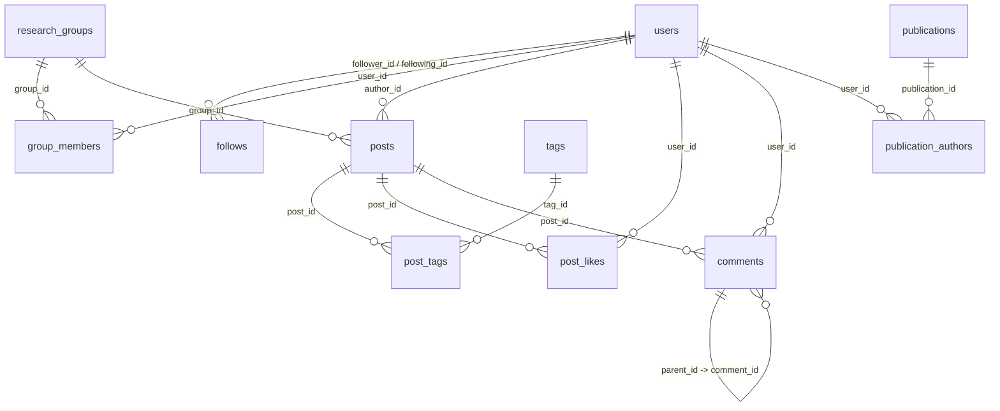

# ARI Research Lab: Nền tảng Mạng Cộng tác Học thuật & Phòng thí nghiệm Tối ưu hóa PostgreSQL

Dự án phát triển hoàn chỉnh từ đề tài **“Thiết kế cơ sở dữ liệu mạng cộng tác và thảo luận học thuật”**, kết hợp ứng dụng mạng xã hội nghiên cứu khoa học thực tế với chiều sâu thực nghiệm **PostgreSQL 18**, **truy vấn đệ quy (`WITH RECURSIVE`)**, **duyệt đồ thị quan hệ** và **tối ưu hóa kế hoạch thực thi (`EXPLAIN ANALYZE`)**.

---

## 1. Kiến trúc Hệ thống & Công nghệ sử dụng

| Tầng | Công nghệ | Chi tiết kỹ thuật |
| :--- | :--- | :--- |
| **Database** | **PostgreSQL 18.1** | Schema quan hệ chuẩn hóa 11 bảng, `WITH RECURSIVE`, GIN Inverted Index cho Full-Text Search, B-Tree composite indexes, Check & Unique Constraints chống chu trình |
| **Backend API** | **Node.js + Express + TypeScript** | Architecture chuẩn Controller-Route, kết nối qua `pg` connection pool, tích hợp engine chạy `EXPLAIN (ANALYZE, BUFFERS)` trực tiếp, benchmark index session, dynamic dataset scaler |
| **Client / Frontend** | **Next.js 16 (App Router) + React 19** | Tailwind CSS v4, Lucide Icons, Canvas HTML5 đồ thị mạng tương tác, bộ render chuỗi bình luận đệ quy đa cấp, phòng thí nghiệm SQL Lab UI |

---

## 2. Thiết kế Cơ sở dữ liệu (Database Schema)

Hệ thống được thiết kế theo mô hình quan hệ chặt chẽ nhằm nghiên cứu 3 cấu trúc dữ liệu kinh điển trong cơ sở dữ liệu:
1. **Mạng đồ thị có hướng (Directed Graph)**: `users → follows → users`
2. **Cây / Rừng phân cấp (Hierarchical Tree / Forest)**: `comments.parent_id → comments.comment_id`
3. **Mối quan hệ Nhiều - Nhiều (Many-to-Many)**: `users ↔ group_members ↔ research_groups`, `posts ↔ post_tags ↔ tags`, `publications ↔ publication_authors ↔ users`



### 11 Bảng dữ liệu chính:
- `users`: Thông tin nhà khoa học, học hàm, trường viện nghiên cứu, mảng lĩnh vực `research_fields TEXT[]`.
- `follows`: Quan hệ theo dõi có hướng giữa 2 nhà nghiên cứu. Ràng buộc `CHECK (follower_id <> following_id)` ngăn tự theo dõi và `PRIMARY KEY (follower_id, following_id)` ngăn trùng lặp.
- `research_groups`: Nhóm/Lab nghiên cứu học thuật theo chủ đề (AI, DBMS, Cybersecurity, Graph Theory).
- `group_members`: Thành viên nhóm với phân quyền: `owner`, `admin`, `member`.
- `posts`: Bài viết học thuật: câu hỏi (`question`), chia sẻ công trình (`research`), thảo luận (`discussion`), bài báo (`paper_share`). Đi kèm cột vector `search_vector tsvector` tự động cập nhật qua trigger.
- `tags` & `post_tags`: Gắn nhãn lĩnh vực khoa học.
- `post_likes`: Lượt đánh giá/thích bài đăng.
- `comments`: Bình luận phân cấp với `parent_id REFERENCES comments(comment_id) ON DELETE CASCADE`.
- `publications` & `publication_authors`: Bài báo khoa học, DOI quốc tế, hội nghị (SIGMOD, VLDB, NeurIPS, ICML), thứ tự đồng tác giả `author_order`.

---

## 3. Các Bài toán SQL Nâng cao Được Nghiên cứu

### Bài toán 1: Tìm người dùng trong mạng lưới theo dõi trong N bước (N-Hop Follower Reachability)
Duyệt tất cả các nhà nghiên cứu mà người dùng $A$ có thể tiếp cận tối đa trong $N$ bước theo dõi. Sử dụng mảng `path` để kiểm tra `NOT (f.following_id = ANY(n.path))` tránh lặp vô hạn khi đồ thị có chu trình:

```sql
WITH RECURSIVE network AS (
    -- Điểm neo: các liên kết bậc 1
    SELECT following_id AS user_id, 1 AS depth, ARRAY[follower_id, following_id] AS path
    FROM follows 
    WHERE follower_id = $1

    UNION ALL

    -- Bước đệ quy: mở rộng bậc tiếp theo
    SELECT f.following_id, n.depth + 1, n.path || f.following_id
    FROM network n
    JOIN follows f ON f.follower_id = n.user_id
    WHERE n.depth < $2 
      AND NOT (f.following_id = ANY(n.path))
)
SELECT 
    u.user_id, u.name, u.institution,
    MIN(n.depth) AS distance,
    COUNT(n.path) AS total_paths_count
FROM network n
JOIN users u ON u.user_id = n.user_id
GROUP BY u.user_id, u.name, u.institution
ORDER BY distance ASC, u.name ASC;
```

---

### Bài toán 2: Tìm đường đi ngắn nhất giữa hai nhà nghiên cứu (Researcher Shortest Path Finder)
Xác định độ tách biệt (degrees of separation) và toàn bộ chuỗi đường đi $A \to C \to D \to B$:

```sql
WITH RECURSIVE path_finder AS (
    SELECT 
        follower_id AS current_node, following_id AS next_node,
        1 AS depth, ARRAY[follower_id, following_id] AS path,
        (following_id = $2) AS found
    FROM follows
    WHERE follower_id = $1

    UNION ALL

    SELECT 
        f.follower_id, f.following_id,
        pf.depth + 1, pf.path || f.following_id,
        (f.following_id = $2) AS found
    FROM path_finder pf
    JOIN follows f ON f.follower_id = pf.next_node
    WHERE pf.depth < 5
      AND NOT (f.following_id = ANY(pf.path))
      AND pf.found = FALSE
)
SELECT depth AS distance, path
FROM path_finder
WHERE next_node = $2
ORDER BY depth ASC
LIMIT 10;
```

---

### Bài toán 3: Truy vấn bình luận phân cấp theo cây (Threaded Comments Tree Query)
Xây dựng đường dẫn sắp xếp `sort_path` để hiển thị bình luận con ngay dưới bình luận cha theo thứ tự cây gia phả (Depth-First Ordering), chỉ với 1 truy vấn duy nhất:

```sql
WITH RECURSIVE comment_tree AS (
    -- Bình luận gốc (root comments)
    SELECT 
        c.comment_id, c.post_id, c.user_id, c.parent_id, c.content, c.created_at,
        0 AS depth,
        ARRAY[c.comment_id] AS sort_path
    FROM comments c
    WHERE c.post_id = $1 AND c.parent_id IS NULL

    UNION ALL

    -- Các câu trả lời con (replies)
    SELECT 
        c.comment_id, c.post_id, c.user_id, c.parent_id, c.content, c.created_at,
        ct.depth + 1,
        ct.sort_path || c.comment_id
    FROM comments c
    JOIN comment_tree ct ON c.parent_id = ct.comment_id
)
SELECT 
    ct.*, u.name AS author_name, u.avatar_url AS author_avatar
FROM comment_tree ct
JOIN users u ON u.user_id = ct.user_id
ORDER BY ct.sort_path ASC;
```

---

### Bài toán 4: Gợi ý người dùng (Academic Collaborative Recommendation)
Gợi ý những nhà nghiên cứu tiềm năng dựa trên:
1. Những người được tài khoản mình theo dõi tiếp tục theo dõi (liên kết 2-hop bạn của bạn).
2. Thành viên có chung nhóm nghiên cứu.
3. Người có chung lĩnh vực nghiên cứu (`research_fields`).
Loại trừ người dùng hiện tại và những người đã theo dõi:

```sql
WITH user_followings AS (SELECT following_id FROM follows WHERE follower_id = $1),
user_groups AS (SELECT group_id FROM group_members WHERE user_id = $1),
candidate_pool AS (
    SELECT f.following_id AS candidate_id, 1.5 AS weight, 'mutual_follow' AS reason
    FROM follows f
    WHERE f.follower_id IN (SELECT following_id FROM user_followings)
      AND f.following_id <> $1 AND f.following_id NOT IN (SELECT following_id FROM user_followings)
    UNION ALL
    SELECT gm.user_id AS candidate_id, 2.0 AS weight, 'shared_group' AS reason
    FROM group_members gm
    WHERE gm.group_id IN (SELECT group_id FROM user_groups)
      AND gm.user_id <> $1 AND gm.user_id NOT IN (SELECT following_id FROM user_followings)
)
SELECT 
    u.user_id, u.name, u.institution,
    SUM(cp.weight) AS recommendation_score,
    COUNT(DISTINCT CASE WHEN cp.reason = 'mutual_follow' THEN 1 END) AS mutual_connections
FROM candidate_pool cp
JOIN users u ON u.user_id = cp.candidate_id
GROUP BY u.user_id, u.name, u.institution
ORDER BY recommendation_score DESC;
```

---

### Bài toán 5: Phát hiện chu trình (Cycle Detection in Academic Follows)
Duyệt và phát hiện các chu trình theo dõi khép kín có độ dài từ 2 đến 4 nút ($A \to B \to C \to A$):

```sql
WITH RECURSIVE cycle_finder AS (
    SELECT follower_id, following_id, 1 AS depth, ARRAY[follower_id, following_id] AS path, (following_id = $1) AS is_cycle
    FROM follows WHERE follower_id = $1
    UNION ALL
    SELECT f.follower_id, f.following_id, cf.depth + 1, cf.path || f.following_id, (f.following_id = $1) AS is_cycle
    FROM cycle_finder cf
    JOIN follows f ON f.follower_id = cf.following_id
    WHERE cf.depth < 4 AND cf.is_cycle = FALSE
      AND (f.following_id = $1 OR NOT (f.following_id = ANY(cf.path)))
)
SELECT depth AS cycle_length, path FROM cycle_finder WHERE is_cycle = TRUE;
```

---

## 4. Kế hoạch Tối ưu hóa & Benchmark Thực nghiệm

Dự án cung cấp giao diện trực quan **PostgreSQL SQL Lab (`/sql-lab`)** để thực nghiệm đo lường:

1. **Chỉ mục Index Scan vs Sequential Scan**:
   - So sánh thời gian thực thi của `WITH RECURSIVE` khi có và không có chỉ mục `idx_follows_follower(follower_id, following_id)`.
   - Đo số lượng khối bộ nhớ đệm `Shared Hit Blocks`.
2. **Phân trang Keyset Pagination (Seek Method) vs OFFSET/LIMIT**:
   - So sánh chi phí khi phân trang sâu. Keyset sử dụng `(created_at, post_id) < ($last_time, $last_id)` đạt độ phức tạp $O(\log N)$ nhờ B-tree index, trong khi `OFFSET 1000` tiêu tốn $O(N)$ do phải quét qua toàn bộ các hàng trước đó.
3. **PostgreSQL Full-Text Search vs ILIKE**:
   - Thử nghiệm tìm kiếm bằng `to_tsquery` với chỉ mục đảo **GIN Index** (`idx_posts_search`) so với quét tuần tự `ILIKE '%query%'`.
4. **Công cụ mở rộng dữ liệu (Dataset Scaler)**:
   - 1-click sinh thêm hàng trăm nút và cạnh quan hệ ngẫu nhiên để quan sát đường cong chi phí thực tế khi đồ thị mở rộng.

---

## 5. Hướng dẫn Cài đặt & Khởi chạy

### Bước 1: Khởi tạo Cơ sở dữ liệu PostgreSQL
Đảm bảo PostgreSQL đang chạy trên cổng `5432` với user `postgres`:
```sql
CREATE DATABASE academic_network_db;
```

### Bước 2: Cài đặt và Chạy Server Backend (Node.js)
```bash
cd server
npm install
npm run db:init     # Tạo bảng và các chỉ mục tối ưu
npm run db:seed     # Nạp dữ liệu mẫu học thuật và mạng theo dõi
npm run dev         # Chạy backend API tại http://localhost:5000
```

### Bước 3: Cài đặt và Chạy Client Frontend (Next.js)
```bash
cd client
npm install
npm run dev         # Chạy ứng dụng web tại http://localhost:3000
```

Truy cập:
- **Trang chủ mạng học thuật**: [http://localhost:3000](http://localhost:3000)
- **Khám phá đồ thị và đường đi**: [http://localhost:3000/network](http://localhost:3000/network)
- **Chuỗi thảo luận đệ quy**: [http://localhost:3000/posts/1](http://localhost:3000/posts/1)
- **Phòng thí nghiệm tối ưu hóa SQL**: [http://localhost:3000/sql-lab](http://localhost:3000/sql-lab)
