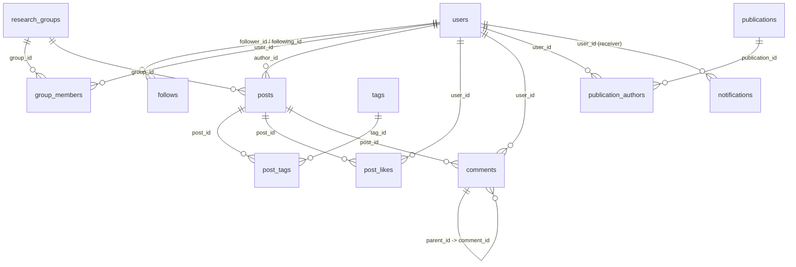

# ARI Research Lab: Nền tảng Mạng Cộng tác Học thuật & Phòng thí nghiệm Tối ưu hóa Cơ sở Dữ liệu Nâng cao

> **Báo cáo Đồ án Học phần Cơ sở Dữ liệu Nâng cao (Thang điểm 10.0)**  
> **Tài liệu Markdown bảo vệ chính thức**: [docs/BAO_CAO_DO_AN_CSDL_NANG_CAO.md](file:///c:/Users/1/Desktop/DA/ARI%20Research%20Lab/docs/BAO_CAO_DO_AN_CSDL_NANG_CAO.md)  
> **Tài liệu Word (.docx) nộp bài chính thức**: [docs/BAO_CAO_DO_AN_CSDL_NANG_CAO.docx](file:///c:/Users/1/Desktop/DA/ARI%20Research%20Lab/docs/BAO_CAO_DO_AN_CSDL_NANG_CAO.docx)

Dự án phát triển hoàn chỉnh từ đề tài **“Thiết kế cơ sở dữ liệu mạng cộng tác và thảo luận học thuật”**, kết hợp ứng dụng mạng xã hội nghiên cứu khoa học thực tế với chiều sâu nghiên cứu học thuật theo chuẩn đầu ra của môn học:
- **Phân tích & Thiết kế**: Mô hình EER có chuyên biệt hóa/tổng quát hóa (`User` $\to$ 4 vai trò, `Post` $\to$ 3 phạm vi), lược đồ quan hệ và từ điển dữ liệu 12 bảng.
- **Phụ thuộc hàm & Chuẩn hóa**: Thuật toán bao đóng $X^+$, tìm khóa, phủ tối tiểu $F_c$, phân tích 3NF/BCNF, chứng minh tính nối không mất mát thông tin (Lossless Join) và bảo toàn phụ thuộc, phân tích chuẩn 4NF với phụ thuộc đa trị (MVDs).
- **SQL nâng cao & Thiết kế vật lý**: Bộ 12 truy vấn SQL nâng cao (Correlated Subquery, `NOT EXISTS`, Multi-table JOINs, Window Functions, Triggers, Stored Procedure PL/pgSQL, Dynamic SQL, Recursive CTEs, và SQL nhúng).
- **CSDL Hướng đối tượng & OQL**: Phân hệ 6 lớp ODL có OID, kế thừa, tập hợp, methods; 5 truy vấn OQL chuẩn ODMG; phân biệt sâu sắc và ánh xạ sang JPQL/JDOQL trên ObjectDB (`objectdb.com`).
- **Transactions & Concurrency**: Kịch bản COMMIT, ROLLBACK với SAVEPOINT, cạnh tranh Lost Update với `SELECT FOR UPDATE`, 3 mức cô lập Isolation Levels, và kịch bản Deadlock Detector.
- **Thực nghiệm đo lường**: Benchmark trực tiếp qua phòng thí nghiệm `SQL Lab` bằng `EXPLAIN (ANALYZE, BUFFERS)` so sánh kết quả thực tế với phân tích độ phức tạp lý thuyết.

---

## 1. Kiến trúc Hệ thống & Ngăn xếp Công nghệ

| Tầng | Công nghệ | Chi tiết kỹ thuật |
| :--- | :--- | :--- |
| **Database Tier** | **PostgreSQL 18.1** | Schema quan hệ chuẩn hóa 12 bảng, `WITH RECURSIVE`, GIN Index FTS, B-Tree composite indexes, Triggers tự động, Check constraints miền giá trị |
| **Backend API Tier**| **Node.js + Express + TypeScript** | Cấu trúc phân tầng Controller-Route-Database, `pg` connection pool, tích hợp engine `EXPLAIN ANALYZE`, dynamic SQL execution |
| **Presentation Tier**| **Next.js 16 (App Router) + React 19** | Tailwind CSS v4, Lucide Icons, Canvas đồ thị mạng tương tác, render cây bình luận đệ quy đa cấp, SQL Lab UI |

---

## 2. Thiết kế Cơ sở Dữ liệu: 12 Bảng Chuẩn Hóa

Hệ thống mô hình hóa 3 cấu trúc dữ liệu cốt lõi:
1. **Mạng đồ thị có hướng (Directed Graph)**: `users → follows → users` (kèm chống chu trình)
2. **Cây phân cấp vô hạn bậc (Hierarchical Tree / Forest)**: `comments.parent_id → comments.comment_id`
3. **Mối quan hệ Nhiều - Nhiều (Many-to-Many)**: `users ↔ group_members ↔ research_groups`, `posts ↔ post_tags ↔ tags`, `publications ↔ publication_authors ↔ users`



### Danh sách 12 Bảng Dữ Liệu:
1. `users`: Nhà nghiên cứu kèm phân quyền (`role`: `admin`, `pi`, `researcher`, `student`), học hàm, viện trường, mảng `research_fields TEXT[]`.
2. `follows`: Mạng lưới theo dõi học giả. Ràng buộc `CHECK (follower_id <> following_id)`.
3. `research_groups`: Phòng Lab nghiên cứu kèm mã mời bí mật `invite_code VARCHAR(64) UNIQUE`.
4. `group_members`: Thành viên Lab kèm vai trò: `owner`, `admin`, `member`.
5. `posts`: Bài viết học thuật chia 3 phạm vi: `community`, `personal`, `lab`; vector tìm kiếm `tsvector`.
6. `tags`: Thẻ lĩnh vực chuyên sâu.
7. `post_tags`: Phân rã MVDs đạt chuẩn 4NF giữa bài viết và thẻ.
8. `post_likes`: Phân rã MVDs đạt chuẩn 4NF giữa bài viết và lượt thích.
9. `comments`: Cây thảo luận phân cấp (`parent_id REFERENCES comments(comment_id) ON DELETE CASCADE`).
10. `publications`: Ấn phẩm khoa học quốc tế, DOI, tạp chí/hội nghị uy tín (SIGMOD, VLDB, KDD).
11. `publication_authors`: Mạng lưới đồng tác giả kèm thứ tự ghi danh `author_order`.
12. `notifications`: Hệ thống thông báo học thuật (lời mời Lab, phản biện, lượt thích).

---

## 3. Bộ Tài Liệu Đồ Án Chuyên Sâu (Thư mục `docs/`)

| File Tài Liệu | Nội Dung Chuyên Môn |
| :--- | :--- |
| **[⭐ BAO_CAO_DO_AN_CSDL_NANG_CAO.md](file:///c:/Users/1/Desktop/DA/ARI%20Research%20Lab/docs/BAO_CAO_DO_AN_CSDL_NANG_CAO.md)** | **Báo cáo tổng kết 6 phần đáp ứng 10.0/10.0 thang điểm chuẩn đầu ra môn học.** |
| **[01. Tổng quan & Ý tưởng](file:///c:/Users/1/Desktop/DA/ARI%20Research%20Lab/docs/01_TONG_QUAN_VA_Y_TUONG.md)** | Bối cảnh mạng xã hội học thuật, Graph, Tree, M-N. |
| **[02. Yêu cầu & Use Case](file:///c:/Users/1/Desktop/DA/ARI%20Research%20Lab/docs/02_YEU_CAU_VA_USE_CASE.md)** | 5 phân hệ chức năng, phi chức năng, Use Case tổng thể. |
| **[03. Mô hình EER & Quan hệ](file:///c:/Users/1/Desktop/DA/ARI%20Research%20Lab/docs/03_THIET_KE_CSDL_ERD_RELATIONAL.md)** | EER Specialization/Generalization, từ điển dữ liệu 12 bảng. |
| **[04. Truy vấn Đệ quy SQL Nâng cao](file:///c:/Users/1/Desktop/DA/ARI%20Research%20Lab/docs/04_TRUY_VAN_DE_QUY_SQL_NANG_CAO.md)** | Phân tích giải thuật đệ quy, Semi-naïve evaluation & WorkTable. |
| **[05. Thực nghiệm & Tối ưu hóa](file:///c:/Users/1/Desktop/DA/ARI%20Research%20Lab/docs/05_THUC_NGHIEM_TOI_UU_HOA_POSTGRESQL.md)** | EXPLAIN ANALYZE: Index Scan vs Seq Scan (7x), Keyset (133x), FTS GIN. |
| **[06. Kiến trúc Hệ thống](file:///c:/Users/1/Desktop/DA/ARI%20Research%20Lab/docs/06_KIEN_TRUC_HE_THONG_VA_LUONG_XU_LY.md)** | Kiến trúc 3-Tier, Sequence Diagrams luồng xử lý. |
| **[07. CSDL Hướng Đối Tượng & OQL](file:///c:/Users/1/Desktop/DA/ARI%20Research%20Lab/docs/07_CSDL_HUONG_DOI_TUONG_VA_OQL.md)** | 6 lớp ODL, 5 truy vấn OQL, so sánh chi tiết & ánh xạ JPQL ObjectDB (`objectdb.com`). |
| **[08. Phụ thuộc Hàm & Chuẩn hóa 3NF/BCNF/4NF](file:///c:/Users/1/Desktop/DA/ARI%20Research%20Lab/docs/08_PHU_THUOC_HAM_CHUAN_HOA_3NF_BCNF_4NF.md)** | Thuật toán $X^+$, tìm khóa, phủ tối tiểu $F_c$, chứng minh Lossless Join & Dependency Preservation, MVDs & 4NF. |

---

## 4. Bộ Scripts SQL Sẵn Sàng Tái Lập (Reproducible Scripts)

- **`server/src/db/schema.sql`**: Tạo 12 bảng và trigger tự động cập nhật `search_vector`.
- **`server/src/db/indexes.sql`**: Tạo B-tree, Composite, GIN indexes.
- **`server/src/db/seed.ts`**: Nạp dữ liệu 10 học giả, 25 quan hệ đồ thị, 4 Lab, bài báo, comments.
- **`server/src/db/advanced_queries.sql`**: 12 truy vấn SQL nâng cao đáp ứng mục 5.3 chuẩn đầu ra.
- **`server/src/db/transaction_scenarios.sql`**: Kịch bản COMMIT, ROLLBACK, Lost Update (`SELECT FOR UPDATE`), 3 mức cô lập và Deadlock.

---

## 5. Hướng dẫn Khởi chạy Nhanh

```bash
# 1. Khởi động Backend API (Cổng 5000)
cd server
npm install
npm run dev

# 2. Khởi động Frontend Client (Cổng 3000)
cd client
npm install
npm run dev
```

Truy cập trên trình duyệt:
- **Trang chủ & Lọc 3 phạm vi bài đăng**: [http://localhost:3000](http://localhost:3000)
- **Mạng lưới học giả & Tìm đường ngắn nhất**: [http://localhost:3000/network](http://localhost:3000/network)
- **Cây thảo luận đệ quy**: [http://localhost:3000/posts/1](http://localhost:3000/posts/1)
- **Phòng thí nghiệm SQL Lab**: [http://localhost:3000/sql-lab](http://localhost:3000/sql-lab)
- **Hệ thống thông báo**: [http://localhost:3000/notifications](http://localhost:3000/notifications)
- **Đăng nhập phân quyền**: [http://localhost:3000/login](http://localhost:3000/login)
