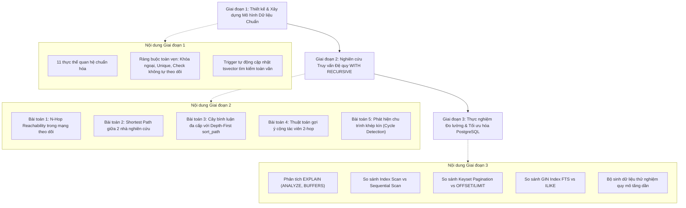

# 01. TỔNG QUAN ĐỀ TÀI & QUÁ TRÌNH LÊN Ý TƯỞNG

---

## 1. Bối cảnh & Lý do chọn đề tài

Trong môi trường học thuật hiện đại, sự kết nối và trao đổi giữa sinh viên, nghiên cứu sinh, giảng viên và các nhà khoa học đóng vai trò quyết định đến tiến độ và chất lượng của các công trình nghiên cứu. Các nền tảng mạng xã hội phổ biến (như Facebook, LinkedIn, X) tuy có độ phủ cao nhưng được thiết kế chủ yếu cho tương tác đại chúng, thiếu các cấu trúc hỗ trợ thảo luận sâu mang tính khoa học:
- **Cấu trúc thảo luận phẳng**: Các bình luận thường bị giới hạn ở 1 hoặc 2 cấp (comment - reply), dẫn đến khó khăn khi theo dõi các chuỗi phản biện học thuật nhiều nhánh chuyên sâu (peer-review threads).
- **Thiếu mối quan hệ mạng học thuật đặc thù**: Mối quan hệ trong giới khoa học không chỉ là "bạn bè" (vô hướng) mà là mạng lưới **theo dõi chuyên môn có hướng (directed follow)**, **tham gia phòng lab nghiên cứu chung (co-membership)**, và **mạng lưới đồng tác giả bài báo (co-authorship)**.
- **Khó khăn trong việc định vị đường liên kết học thuật**: Ví dụ: *"Làm thế nào để nhà nghiên cứu trẻ A tìm được người thầy B gián tiếp qua mạng lưới giáo sư cố vấn trong tối đa 3 bước?"* hoặc *"Hai nhà khoa học có chu trình theo dõi học thuật khép kín nào không?"*.

Từ bối cảnh thực tiễn đó, đề tài **“Thiết kế cơ sở dữ liệu mạng cộng tác và thảo luận học thuật (ARI Research Lab)”** được đề xuất phát triển thành một hệ thống vừa mang tính ứng dụng thực tế, vừa sở hữu **chiều sâu nghiên cứu học thuật về hệ quản trị cơ sở dữ liệu quan hệ (PostgreSQL)**.

---

## 2. Mục tiêu Nghiên cứu & Phạm vi Dự án

Mục tiêu cốt lõi của đề tài **không dừng lại ở việc tạo ra các thao tác CRUD cơ bản** (Create - Read - Update - Delete), mà tập trung giải quyết bài toán:

> **"Làm thế nào để mô hình hóa, lưu trữ, truy vấn đệ quy và tối ưu hóa hiệu năng các cấu trúc dữ liệu dạng mạng (Graph) và cây phân cấp (Tree) trực tiếp bên trong hệ quản trị cơ sở dữ liệu quan hệ PostgreSQL bằng SQL thuần túy?"**

### Phạm vi dự án được phân chia thành 3 giai đoạn:

---

## 3. Ba Cấu trúc Dữ liệu Trọng tâm trong Cơ sở dữ liệu

Đề tài giải quyết bài toán biểu diễn 3 cấu trúc dữ liệu kinh điển trên nền tảng RDBMS quan hệ:

| Cấu trúc dữ liệu | Biểu diễn trong Cơ sở dữ liệu | Ý nghĩa Nghiên cứu Học thuật |
| :--- | :--- | :--- |
| **Đồ thị có hướng (Directed Graph)** | `users → follows → users` | Mối quan hệ $1$ người theo dõi nhiều người, và $1$ người được nhiều người theo dõi. Đặt ra bài toán duyệt lan truyền (reachability), tìm đường đi ngắn nhất (shortest path), và kiểm soát chu trình vô hạn (cycle prevention). |
| **Cây / Rừng phân cấp (Hierarchical Tree/Forest)** | `comments.parent_id → comments.comment_id` | Bình luận con trỏ về bình luận cha hình thành một rừng cây (forest) phân cấp theo từng bài viết. Đặt ra bài toán duyệt cây đệ quy và sắp xếp thứ tự nhánh (branch sorting) tối ưu trong 1 câu truy vấn SQL. |
| **Quan hệ Nhiều - Nhiều (Many-to-Many Networks)** | `users ↔ group_members ↔ research_groups` `posts ↔ post_tags ↔ tags` `publications ↔ publication_authors ↔ users` | Đại diện cho các cộng đồng nghiên cứu, cụm bài viết theo chủ đề, và mạng lưới hợp tác đồng tác giả công trình khoa học quốc tế. |

---

## 4. Giá trị Đóng góp của Đề tài

1. **Về mặt Khoa học Dữ liệu & Hệ quản trị CSDL**:
   - Khảo sát thực tế cơ chế đánh giá bán ngây thơ (**Semi-naïve Evaluation**) mà PostgreSQL áp dụng cho `WITH RECURSIVE`.
   - Chứng minh cách dùng mảng đường đi (`ARRAY[path]`) và hàm mảng `ANY(path)` để khử chu trình trong đồ thị chu trình tổng quát.
   - Làm rõ sự khác biệt giữa chi phí quét chỉ mục $O(\log N)$ của **Keyset Pagination** so với chi phí quét trượt $O(N)$ của **OFFSET/LIMIT**.
2. **Về mặt Ứng dụng Thực tiễn**:
   - Nền tảng web hiện đại với giao diện Next.js, API Node.js phân tầng rõ ràng.
   - Trực quan hóa đồ thị Canvas thời gian thực, cho phép tương tác trực quan với các thuật toán cơ sở dữ liệu.
   - Bộ công cụ đo lường hiệu năng (**SQL Optimization Lab**) tích hợp sẵn trong ứng dụng giúp người học, kỹ sư CSDL có thể tự tái lập các bài toán tối ưu trực tiếp trên PostgreSQL 18.
