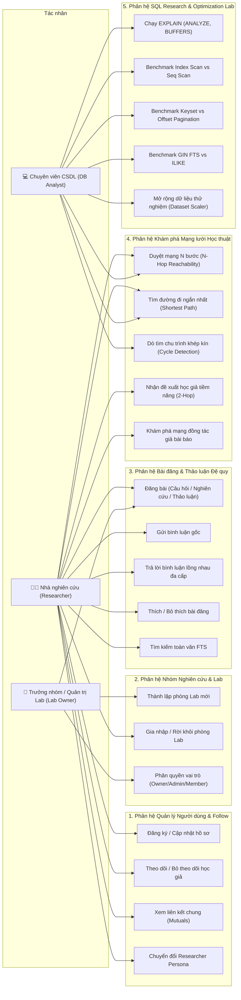

# 02. PHÂN TÍCH YÊU CẦU & THIẾT KẾ USE CASE

---

## 1. Các Tác nhân Hệ thống (Actors)

| Tác nhân | Mô tả vai trò |
| :--- | :--- |
| **Nhà nghiên cứu / Học giả (Researcher)** | Tác nhân chính tham gia nền tảng: tạo hồ sơ, kết nối theo dõi đồng nghiệp, thành lập/gia nhập phòng lab, đăng bài viết thảo luận và phản hồi bình luận đa cấp. |
| **Trưởng nhóm / Quản trị Lab (Lab Owner / Admin)** | Người khởi xướng phòng nghiên cứu, quản lý thành viên, kiểm duyệt các bài viết và chủ đề học thuật trong lab. |
| **Chuyên viên / Nghiên cứu sinh CSDL (DB Analyst)** | Người sử dụng hệ thống để thực nghiệm các truy vấn đệ quy, đo lường kế hoạch thực thi `EXPLAIN ANALYZE`, so sánh chỉ mục và đánh giá hiệu năng database. |
| **Khách vãng lai (Guest)** | Người xem công khai các bài báo khoa học, cây thảo luận và mạng lưới cộng tác mà không cần định danh. |

---

## 2. Yêu cầu Chức năng (Functional Requirements - FR)

### Phân hệ 1: Quản lý Người dùng & Mạng theo dõi (User & Follow Graph)
- **FR1.1**: Đăng ký, đăng nhập, cập nhật hồ sơ cá nhân (trường viện, tiểu sử, mảng nghiên cứu `research_fields`).
- **FR1.2**: Theo dõi (Follow) và Hủy theo dõi (Unfollow) học giả khác.
- **FR1.3**: Ràng buộc không cho phép người dùng tự theo dõi chính mình (`chk_not_self_follow`).
- **FR1.4**: Xem danh sách người theo dõi chung (mutual followings / mutual followers) giữa hai nhà nghiên cứu.
- **FR1.5**: Chuyển đổi linh hoạt giữa các danh tính nghiên cứu (Persona Switching) để kiểm thử mạng lưới đa chiều.

### Phân hệ 2: Nhóm Cộng tác & Phòng Lab Học thuật (Research Groups)
- **FR2.1**: Thành lập nhóm nghiên cứu mới với chủ đề chuyên sâu (AI, DBMS, Cybersecurity, Graph Theory).
- **FR2.2**: Gia nhập (Join) hoặc rời khỏi (Leave) phòng lab.
- **FR2.3**: Phân quyền vai trò rõ ràng: `owner` (trưởng nhóm), `admin` (quản trị viên), `member` (thành viên).
- **FR2.4**: Xem danh sách thành viên và các bài đăng dành riêng cho nhóm.

### Phân hệ 3: Bài đăng & Chuỗi Thảo luận Đệ quy (Posts & Hierarchical Comments)
- **FR3.1**: Đăng tải nội dung học thuật thuộc 4 thể loại: Câu hỏi (`question`), Nghiên cứu gốc (`research`), Thảo luận (`discussion`), Bài báo (`paper_share`).
- **FR3.2**: Gắn nhãn từ khóa chuyên ngành (`tags`).
- **FR3.3**: Bình luận gốc (root comment) cho bài viết.
- **FR3.4**: Trả lời bình luận lồng nhau không giới hạn cấp độ (Nested replies at depth $0, 1, 2, 3, \dots$).
- **FR3.5**: Hiển thị chuỗi thảo luận theo thứ tự cây gia phả (Depth-First branch ordering) với thông tin độ sâu (`depth`) và mảng thứ tự (`sort_path`).
- **FR3.6**: Xóa bình luận cha sẽ tự động xóa toàn bộ nhánh phản hồi con nhờ ràng buộc `ON DELETE CASCADE`.

### Phân hệ 4: Khám phá Đồ thị Mạng lưới (Graph Traversal & Analytics)
- **FR4.1**: Trực quan hóa cấu trúc đồ thị mạng theo dõi trực tiếp trên HTML5 Canvas.
- **FR4.2**: Duyệt tầm với trong mạng lưới $N$ bước (N-Hop Reachability) bằng `WITH RECURSIVE`.
- **FR4.3**: Dò tìm đường đi ngắn nhất (Shortest Path) và toàn bộ các đường liên kết giữa 2 nhà nghiên cứu.
- **FR4.4**: Phát hiện chu trình theo dõi khép kín ($A \to B \to C \to A$) với độ dài từ 2 đến 4 nút.
- **FR4.5**: Gợi ý nhà nghiên cứu tiềm năng dựa trên thuật toán 2-hop (bạn của bạn + nhóm chung + đề tài chung).
- **FR4.6**: Thống kê mạng lưới đồng tác giả bài báo khoa học (Co-authorship graph).

### Phân hệ 5: Phòng thí nghiệm Tối ưu hóa PostgreSQL (SQL Optimization Lab)
- **FR5.1**: Thực thi `EXPLAIN (ANALYZE, BUFFERS)` trực tiếp trên 5 bài toán SQL đệ quy cốt lõi.
- **FR5.2**: Thực nghiệm so sánh hiệu năng có chỉ mục (Index Scan) và không có chỉ mục (Sequential Scan) trong phiên làm việc.
- **FR5.3**: Thực nghiệm so sánh phân trang Keyset Pagination $O(\log N)$ với `OFFSET/LIMIT` $O(N)$ trên dữ liệu lớn.
- **FR5.4**: Thực nghiệm so sánh PostgreSQL Full-Text Search (GIN `to_tsquery`) với quét chuỗi thông thường `ILIKE`.
- **FR5.5**: Tự động sinh dữ liệu quy mô lớn (Dataset Scaler) với hàng trăm nút và hàng nghìn cạnh để đo lường độ phức tạp thuật toán.

---

## 3. Yêu cầu Phi chức năng (Non-Functional Requirements - NFR)

1. **Hiệu năng (Performance)**: Các truy vấn đệ quy trong phạm vi 3 bước trên đồ thị $10.000$ cạnh phải trả lời dưới $100\text{ ms}$ nhờ chỉ mục hỗn hợp `(follower_id, following_id)`.
2. **Tính toàn vẹn dữ liệu (Data Integrity)**: Toàn bộ quan hệ phải đảm bảo tính toàn vẹn tham chiếu thông qua khóa ngoại, khóa chính phức hợp và kiểm tra logic mức CSDL.
3. **Khả năng mở rộng (Scalability)**: Hỗ trợ nạp tăng cường hàng nghìn bản ghi thử nghiệm mà không làm sập bộ nhớ đệm `WorkTable` của PostgreSQL.
4. **Bảo mật & Tách biệt (Security)**: Kết nối database sử dụng Connection Pool với tài khoản định danh, phân quyền rõ ràng trên API.

---

## 4. Sơ đồ Use Case Tổng thể (Mermaid Diagram)

---

## 5. Đặc tả Chi tiết Các Use Case Trọng tâm

### Use Case UC3.3: Trả lời bình luận lồng nhau đa cấp (Reply Threaded Comment)
- **Tác nhân**: Nhà nghiên cứu.
- **Tiền điều kiện**: Người dùng đã đăng nhập hoặc chọn danh tính; bình luận cha (`parent_id`) đang tồn tại trên hệ thống.
- **Luồng chính**:
  1. Người dùng chọn nút "Reply" tại một bình luận có độ sâu $k$ bất kỳ (ví dụ $k=2$).
  2. Người dùng nhập nội dung phản biện học thuật và nhấn "Submit Reply".
  3. Client gửi request `POST /api/comments/post/:postId` kèm `{ parent_id, content }`.
  4. Backend kiểm tra `parent_id` có thuộc cùng `post_id` hay không.
  5. Backend thực hiện `INSERT INTO comments (post_id, user_id, parent_id, content) VALUES (...)`.
  6. PostgreSQL kích hoạt câu truy vấn đệ quy `WITH RECURSIVE comment_tree` tái tạo lại cây thảo luận với `sort_path` mới.
  7. Client hiển thị bình luận mới ngay dưới nhánh của bình luận cha với độ sâu $k+1$.
- **Hậu điều kiện**: Nhánh thảo luận được phân cấp chính xác; số lượng phản hồi trực tiếp được cập nhật.

---

### Use Case UC4.2: Dò tìm đường đi giữa hai nhà nghiên cứu (Shortest Path Finder)
- **Tác nhân**: Nhà nghiên cứu / Chuyên viên CSDL.
- **Tiền điều kiện**: Nút bắt đầu (Source A) và nút kết thúc (Target B) là hai học giả khác nhau ($A \ne B$).
- **Luồng chính**:
  1. Người dùng chọn Source $A$ và Target $B$ trên giao diện Network Traversal.
  2. Người dùng nhấn nút "Compute Connection Paths".
  3. Client gửi request `GET /api/network/path?sourceId=A&targetId=B&maxDepth=5`.
  4. Backend thực thi truy vấn CTE đệ quy `WITH RECURSIVE path_finder`.
  5. PostgreSQL duyệt theo BFS (Breadth-First Search) có kiểm tra chu trình `NOT (f.following_id = ANY(pf.path))`.
  6. Kết quả trả về danh sách các đường đi có độ dài ngắn nhất kèm danh sách các học giả trung gian.
  7. Canvas đồ thị tự động vẽ nổi bật (highlight glow) chuỗi cạnh nối $A \to \dots \to B$.
- **Hậu điều kiện**: Hiển thị số bước (degrees of separation) và thời gian thực thi của database tính bằng mili-giây.

---

### Use Case UC5.2: Thực nghiệm Chỉ mục (Index vs Non-Index Benchmark)
- **Tác nhân**: Chuyên viên CSDL.
- **Tiền điều kiện**: Database đã có dữ liệu mẫu của mạng học thuật.
- **Luồng chính**:
  1. Người dùng truy cập trang `/sql-lab`, chọn tab "Index Comparison".
  2. Chọn mục tiêu kiểm thử: Mạng theo dõi (`follows`) hoặc Cây bình luận (`comments`).
  3. Nhấn "Run Benchmark".
  4. Backend mở kết nối riêng biệt (connection session) và thực hiện:
     - Chạy với Index: `SET enable_indexscan = on; EXPLAIN (ANALYZE, BUFFERS) ...`
     - Chạy quét tuần tự: `SET enable_indexscan = off; SET enable_bitmapscan = off; EXPLAIN (ANALYZE, BUFFERS) ...`
     - Khôi phục cấu hình mặc định.
  5. Backend tính toán hệ số tăng tốc $\text{Speedup Factor} = \frac{T_{\text{no\_index}}}{T_{\text{with\_index}}}$.
  6. Giao diện hiển thị trực quan biểu đồ so sánh Execution Time, Planning Time, và số khối Shared Hit Blocks.
- **Hậu điều kiện**: Chuyên viên thu được bằng chứng thực nghiệm định lượng về vai trò của composite B-tree index trên truy vấn đệ quy.
