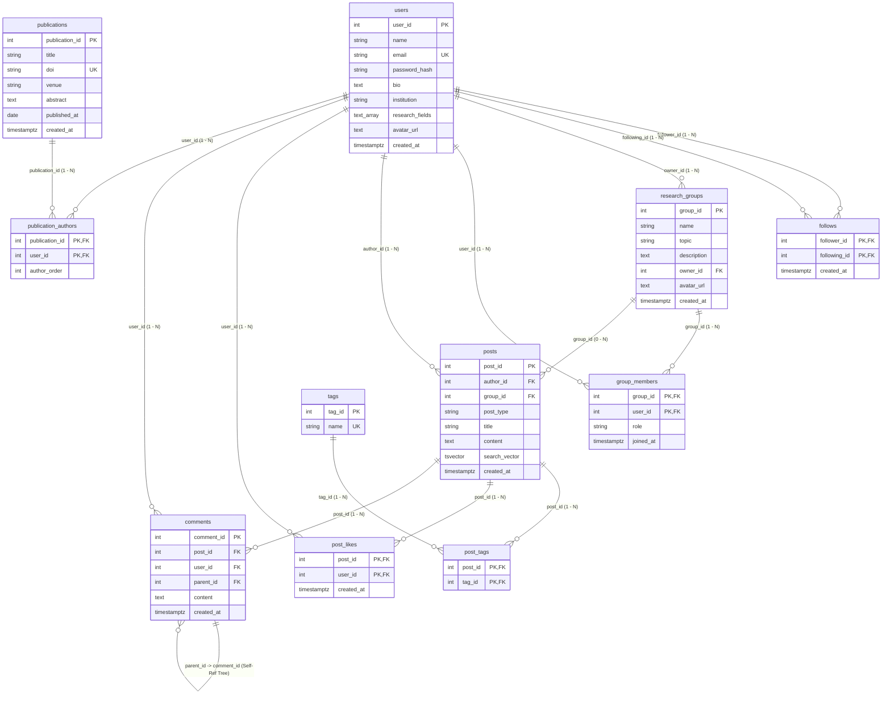

# 03. THIẾT KẾ CƠ SỞ DỮ LIỆU: ERD & SƠ ĐỒ QUAN HỆ

---

## 1. Mô hình Thực thể - Liên kết (Entity-Relationship Diagram - ERD)

Mô hình dữ liệu của **ARI Research Lab** gồm 11 thực thể quan hệ, được biểu diễn bằng cú pháp chuẩn Mermaid ERD dưới đây:



---

## 2. Sơ đồ Quan hệ (Relational Schema Diagram)

Dưới đây là sơ đồ lược đồ quan hệ chuẩn dạng văn bản mô tả các bảng, khóa chính (gạch chân), khóa ngoại (kèm ký hiệu FK), và các ràng buộc toàn vẹn:

```
users (
    user_id [PK], name, email [UK], password_hash, bio, institution, 
    research_fields, avatar_url, created_at
)

follows (
    follower_id [PK, FK -> users.user_id ON DELETE CASCADE],
    following_id [PK, FK -> users.user_id ON DELETE CASCADE],
    created_at
    * CONSTRAINT chk_not_self_follow CHECK (follower_id <> following_id)
)

research_groups (
    group_id [PK], name, topic, description, 
    owner_id [FK -> users.user_id ON DELETE SET NULL],
    avatar_url, created_at
)

group_members (
    group_id [PK, FK -> research_groups.group_id ON DELETE CASCADE],
    user_id [PK, FK -> users.user_id ON DELETE CASCADE],
    role [CHECK IN ('owner', 'admin', 'member')],
    joined_at
)

posts (
    post_id [PK],
    author_id [FK -> users.user_id ON DELETE CASCADE],
    group_id [FK -> research_groups.group_id ON DELETE SET NULL],
    post_type [CHECK IN ('discussion', 'question', 'research', 'paper_share')],
    title, content, search_vector, created_at
)

tags (
    tag_id [PK], name [UK]
)

post_tags (
    post_id [PK, FK -> posts.post_id ON DELETE CASCADE],
    tag_id [PK, FK -> tags.tag_id ON DELETE CASCADE]
)

post_likes (
    post_id [PK, FK -> posts.post_id ON DELETE CASCADE],
    user_id [PK, FK -> users.user_id ON DELETE CASCADE],
    created_at
)

comments (
    comment_id [PK],
    post_id [FK -> posts.post_id ON DELETE CASCADE],
    user_id [FK -> users.user_id ON DELETE CASCADE],
    parent_id [FK -> comments.comment_id ON DELETE CASCADE],
    content, created_at
)

publications (
    publication_id [PK], title, doi [UK], venue, abstract, published_at, created_at
)

publication_authors (
    publication_id [PK, FK -> publications.publication_id ON DELETE CASCADE],
    user_id [PK, FK -> users.user_id ON DELETE CASCADE],
    author_order
)
```

---

## 3. Từ điển Dữ liệu Chi tiết (Data Dictionary)

### 3.1. Bảng `users` (Nhà nghiên cứu / Người dùng)
| Tên cột | Kiểu dữ liệu | Khóa / Ràng buộc | Ý nghĩa |
| :--- | :--- | :--- | :--- |
| `user_id` | `SERIAL` | **PRIMARY KEY** | Định danh duy nhất của học giả |
| `name` | `VARCHAR(120)` | `NOT NULL` | Họ và tên học giả kèm học vị |
| `email` | `VARCHAR(150)` | `UNIQUE, NOT NULL` | Email học thuật |
| `password_hash` | `VARCHAR(255)` | `DEFAULT '...'` | Mật khẩu băm an toàn |
| `bio` | `TEXT` | `NULLABLE` | Tóm tắt hướng nghiên cứu & tiểu sử |
| `institution` | `VARCHAR(200)` | `NULLABLE` | Trường Đại học / Viện nghiên cứu |
| `research_fields`| `TEXT[]` | `DEFAULT '{}'` | Mảng các lĩnh vực chuyên sâu (AI, DBMS, ...) |
| `avatar_url` | `TEXT` | `NULLABLE` | Đường dẫn ảnh đại diện |
| `created_at` | `TIMESTAMPTZ`| `DEFAULT NOW()` | Thời điểm khởi tạo hồ sơ |

### 3.2. Bảng `follows` (Quan hệ theo dõi - Directed Graph)
| Tên cột | Kiểu dữ liệu | Khóa / Ràng buộc | Ý nghĩa |
| :--- | :--- | :--- | :--- |
| `follower_id` | `INT` | **PK**, **FK** `users.user_id` | ID người theo dõi |
| `following_id` | `INT` | **PK**, **FK** `users.user_id` | ID người được theo dõi |
| `created_at` | `TIMESTAMPTZ`| `DEFAULT NOW()` | Thời điểm bắt đầu theo dõi |
- **Ràng buộc toàn vẹn**:
  - `PRIMARY KEY (follower_id, following_id)`: Không cho phép theo dõi trùng lặp.
  - `CONSTRAINT chk_not_self_follow CHECK (follower_id <> following_id)`: Ngăn người dùng tự tạo vòng lặp tự theo dõi chính mình.

### 3.3. Bảng `research_groups` (Phòng Lab / Nhóm Học thuật)
| Tên cột | Kiểu dữ liệu | Khóa / Ràng buộc | Ý nghĩa |
| :--- | :--- | :--- | :--- |
| `group_id` | `SERIAL` | **PRIMARY KEY** | Mã định danh nhóm |
| `name` | `VARCHAR(150)` | `NOT NULL` | Tên phòng nghiên cứu / lab |
| `topic` | `VARCHAR(150)` | `NOT NULL` | Chủ đề trọng tâm (VD: Database Optimization) |
| `description` | `TEXT` | `NULLABLE` | Mục tiêu và định hướng thí nghiệm |
| `owner_id` | `INT` | **FK** `users.user_id` | Trưởng nhóm / Giáo sư phụ trách |
| `avatar_url` | `TEXT` | `NULLABLE` | Ảnh đại diện phòng lab |
| `created_at` | `TIMESTAMPTZ`| `DEFAULT NOW()` | Ngày thành lập |

### 3.4. Bảng `group_members` (Thành viên Nhóm - Many to Many)
| Tên cột | Kiểu dữ liệu | Khóa / Ràng buộc | Ý nghĩa |
| :--- | :--- | :--- | :--- |
| `group_id` | `INT` | **PK**, **FK** `groups.group_id` | Mã nhóm nghiên cứu |
| `user_id` | `INT` | **PK**, **FK** `users.user_id` | Mã nhà nghiên cứu |
| `role` | `VARCHAR(20)` | `CHECK IN ('owner','admin','member')` | Phân quyền trong nhóm |
| `joined_at` | `TIMESTAMPTZ`| `DEFAULT NOW()` | Thời điểm gia nhập |

### 3.5. Bảng `posts` (Bài đăng Khoa học)
| Tên cột | Kiểu dữ liệu | Khóa / Ràng buộc | Ý nghĩa |
| :--- | :--- | :--- | :--- |
| `post_id` | `SERIAL` | **PRIMARY KEY** | Mã định danh bài viết |
| `author_id` | `INT` | **FK** `users.user_id` | Tác giả bài viết |
| `group_id` | `INT` | **FK** `groups.group_id` | Thuộc nhóm (NULL nếu đăng chung) |
| `post_type` | `VARCHAR(30)` | `CHECK IN (...)` | Thể loại: `question`, `research`, `discussion`, `paper_share` |
| `title` | `VARCHAR(300)` | `NOT NULL` | Tiêu đề công trình / câu hỏi |
| `content` | `TEXT` | `NOT NULL` | Toàn văn nội dung học thuật |
| `search_vector`| `tsvector` | `NULLABLE` | Vector từ tố cho PostgreSQL Full-Text Search |
| `created_at` | `TIMESTAMPTZ`| `DEFAULT NOW()` | Thời điểm đăng tải |

### 3.6. Bảng `comments` (Cây Thảo luận Phân cấp - Self-Referencing Tree)
| Tên cột | Kiểu dữ liệu | Khóa / Ràng buộc | Ý nghĩa |
| :--- | :--- | :--- | :--- |
| `comment_id` | `SERIAL` | **PRIMARY KEY** | Mã định danh bình luận |
| `post_id` | `INT` | **FK** `posts.post_id` | Thuộc bài viết nào |
| `user_id` | `INT` | **FK** `users.user_id` | Người phản hồi |
| `parent_id` | `INT` | **FK** `comments.comment_id` | Bình luận cha (NULL nếu là bình luận gốc) |
| `content` | `TEXT` | `NOT NULL` | Nội dung phản biện |
| `created_at` | `TIMESTAMPTZ`| `DEFAULT NOW()` | Thời điểm gửi |
- **Ràng buộc toàn vẹn**:
  - `FOREIGN KEY (parent_id) REFERENCES comments(comment_id) ON DELETE CASCADE`: Khi xóa một nhánh bình luận cha, toàn bộ các bình luận con cháu sâu bên dưới sẽ tự động được thu hồi an toàn.

### 3.7. Bảng `publications` & `publication_authors` (Công trình Khoa học & Đồng tác giả)
| Tên cột | Kiểu dữ liệu | Khóa / Ràng buộc | Ý nghĩa |
| :--- | :--- | :--- | :--- |
| `publication_id`| `SERIAL` | **PRIMARY KEY** | Mã công trình nghiên cứu |
| `title` | `VARCHAR(350)` | `NOT NULL` | Tiêu đề bài báo quốc tế |
| `doi` | `VARCHAR(150)` | `UNIQUE` | Định danh tài liệu số Digital Object Identifier |
| `venue` | `VARCHAR(200)` | `NULLABLE` | Hội nghị / Tạp chí xuất bản (SIGMOD, VLDB, ...) |
| `abstract` | `TEXT` | `NULLABLE` | Tóm tắt bài báo khoa học |
| `published_at` | `DATE` | `NULLABLE` | Ngày công bố |
| `author_order` | `INT` | `DEFAULT 1` (trong `publication_authors`) | Thứ tự tác giả: 1 (chính), 2, 3... |

---

## 4. Chiến lược Thiết kế Chỉ mục Tối ưu (Indexing Strategy)

Các chỉ mục được tạo trong [indexes.sql](file:///c:/Users/1/Desktop/DA/ARI%20Research%20Lab/server/src/db/indexes.sql) phục vụ trực tiếp cho các phép nối đệ quy:

```sql
-- 1. Tối ưu duyệt đồ thị có hướng (Directed Graph Traversal)
CREATE INDEX idx_follows_follower ON follows (follower_id, following_id);
CREATE INDEX idx_follows_following ON follows (following_id, follower_id);

-- 2. Tối ưu duyệt cây phân cấp bình luận (Hierarchical Comment Tree)
CREATE INDEX idx_comments_parent ON comments (parent_id);
CREATE INDEX idx_comments_post ON comments (post_id, parent_id);
CREATE INDEX idx_comments_post_created ON comments (post_id, created_at ASC);

-- 3. Tối ưu phân trang Keyset dòng thời gian (Keyset Pagination)
CREATE INDEX idx_posts_author_created ON posts (author_id, created_at DESC);
CREATE INDEX idx_posts_group_created ON posts (group_id, created_at DESC);
CREATE INDEX idx_posts_created_id ON posts (created_at DESC, post_id DESC);

-- 4. Tối ưu tìm kiếm văn bản toàn phần (PostgreSQL Full-Text Search)
CREATE INDEX idx_posts_search ON posts USING GIN (search_vector);

-- 5. Tối ưu cộng đồng nhóm & liên kết đồng tác giả
CREATE INDEX idx_group_members_user ON group_members (user_id, group_id);
CREATE INDEX idx_pub_authors_user ON publication_authors (user_id);
```

### Phân tích kỹ thuật của các chỉ mục:
1. **Composite Index `(follower_id, following_id)`**:
   - Cho phép PostgreSQL thực hiện **Index-Only Scan** trong bước đệ quy của `WITH RECURSIVE`, đọc trực tiếp `following_id` từ B-tree leaf page mà không cần truy xuất vào heap page của bảng `follows`.
2. **Index `(parent_id)` và `(post_id, parent_id)`**:
   - Giảm độ phức tạp tìm kiếm các bình luận con từ $O(N)$ (quét toàn bảng comments) xuống $O(\log N + K)$ trong đó $K$ là số bình luận con trực tiếp.
3. **Composite Index `(created_at DESC, post_id DESC)`**:
   - Khóa phục vụ cho thuật toán **Keyset Seek Pagination**. PostgreSQL thực hiện B-tree jump ngay tại vị trí bản ghi cuối cùng thay vì phải đọc bỏ qua (skip) hàng nghìn dòng như của `OFFSET`.
4. **GIN Index (Generalized Inverted Index)**:
   - Lưu trữ danh sách các lexeme và con trỏ đến các bài viết chứa từ tố đó, giúp thời gian tìm kiếm câu hỏi/tài liệu học thuật đạt tốc độ dưới $1\text{ ms}$.
