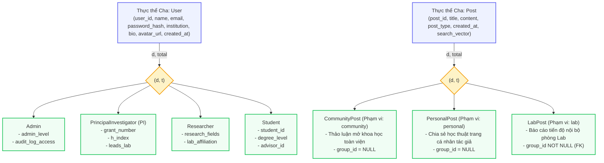
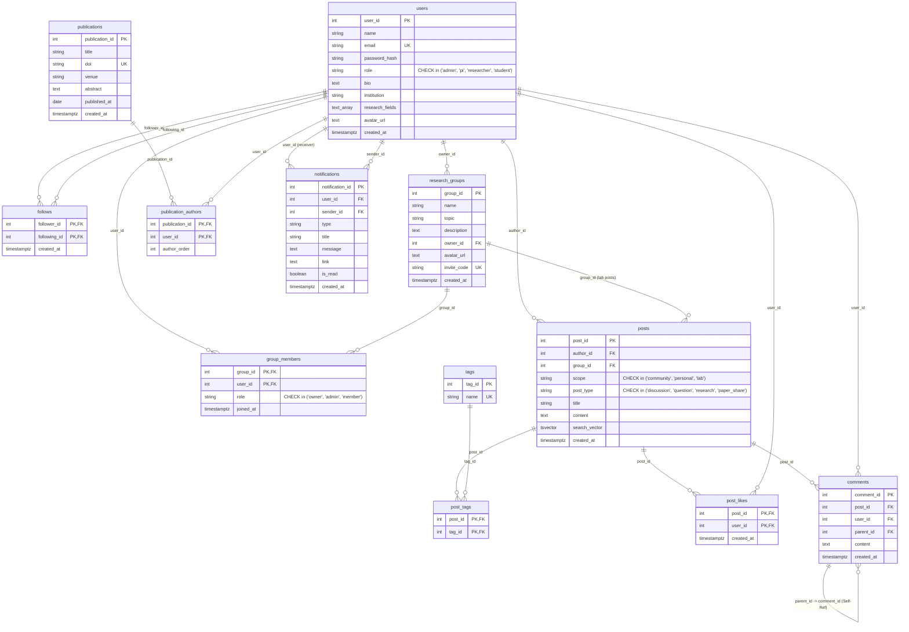
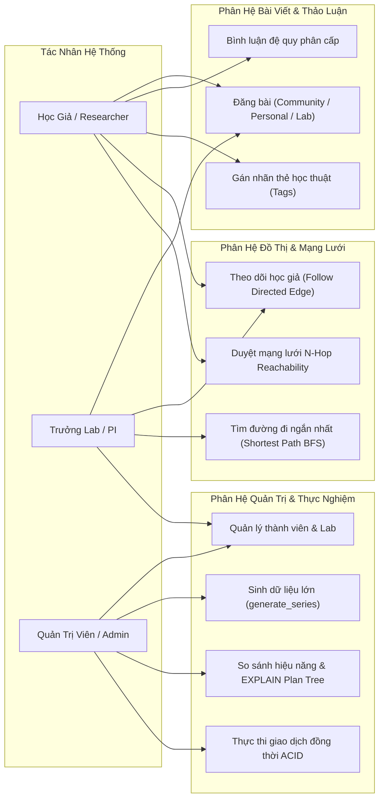
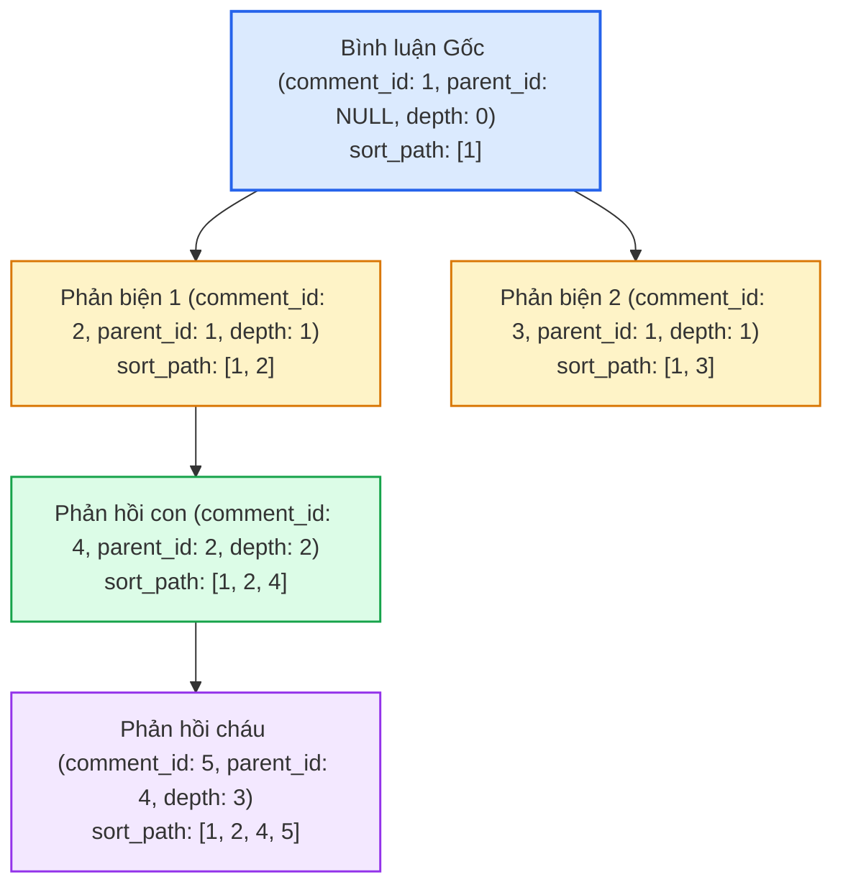
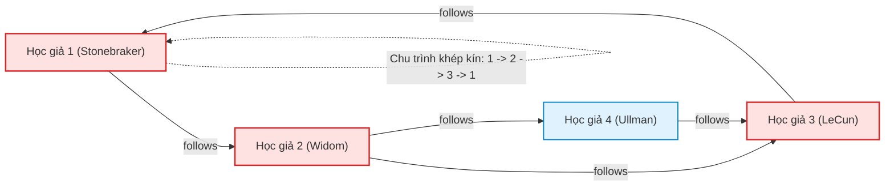
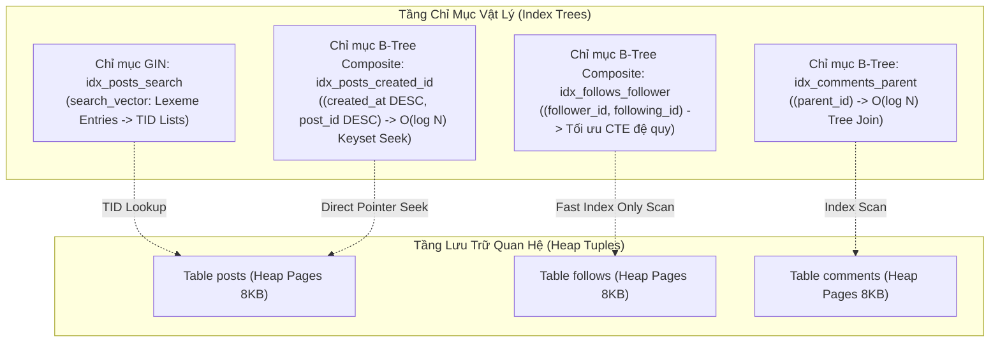

# 03. THIẾT KẾ CƠ SỞ DỮ LIỆU: MÔ HÌNH EER, SƠ ĐỒ QUAN HỆ & TỪ ĐIỂN DỮ LIỆU

---

## 1. Mô hình Thực thể Mở rộng (Enhanced Entity-Relationship Diagram - EER)

Mô hình EER của **ARI Research Lab** mở rộng mô hình ER truyền thống bằng việc tích hợp cơ chế **Tổng quát hóa / Chuyên biệt hóa (Generalization / Specialization)** cho hai thực thể trung tâm: **Người dùng (`User`)** và **Bài viết (`Post`)**.

### 1.1. Phân tích Chuyên biệt hóa (Specialization / Generalization)



#### Quy tắc ngữ nghĩa của Chuyên biệt hóa:
1. **Thực thể `User`**:
   - **Ràng buộc rời rạc (Disjoint - $d$)**: Tại một thời điểm, một học giả thuộc đúng một vai trò chính (`admin`, `pi`, `researcher`, `student`) được kiểm tra qua `CHECK (role IN ('admin', 'pi', 'researcher', 'student'))`.
   - **Ràng buộc toàn phần (Total - $t$)**: Mọi cá nhân trong hệ thống bắt buộc phải thuộc một trong 4 phân lớp trên.
   - **Ánh xạ quan hệ (Relational Mapping)**: Áp dụng chiến lược **Single Table with Type Discriminator** (Bảng đơn kết hợp cột phân biệt `role`) để tối ưu hóa hiệu năng truy vấn JOIN và chỉ mục B-tree.
2. **Thực thể `Post`**:
   - **Ràng buộc rời rạc (Disjoint - $d$) & Toàn phần (Total - $t$)**: Mỗi bài viết có đúng một phạm vi duy nhất (`scope IN ('community', 'personal', 'lab')`).
   - Ràng buộc toàn vẹn miền giá trị nghiệp vụ:
     $$\text{scope} = \text{'lab'} \iff \text{group\_id IS NOT NULL}$$
     $$\text{scope} \in \{\text{'community'}, \text{'personal'}\} \iff \text{group\_id IS NULL}$$

---

### 1.2. Sơ đồ Thực thể - Liên kết Toàn Thể (EER Diagram)

Dưới đây là sơ đồ tương tác giữa toàn bộ 12 thực thể quan hệ của hệ thống ARI Research Lab:



---

## 2. Lược Đồ Quan Hệ (Relational Schema)

```
1. users (
    user_id [PK], name, email [UK], password_hash, role, bio, 
    institution, research_fields, avatar_url, created_at
)

2. follows (
    follower_id [PK, FK -> users.user_id ON DELETE CASCADE],
    following_id [PK, FK -> users.user_id ON DELETE CASCADE],
    created_at
    * CONSTRAINT chk_not_self_follow CHECK (follower_id <> following_id)
)

3. research_groups (
    group_id [PK], name, topic, description, 
    owner_id [FK -> users.user_id ON DELETE SET NULL],
    avatar_url, invite_code [UK], created_at
)

4. group_members (
    group_id [PK, FK -> research_groups.group_id ON DELETE CASCADE],
    user_id [PK, FK -> users.user_id ON DELETE CASCADE],
    role [CHECK IN ('owner', 'admin', 'member')],
    joined_at
)

5. posts (
    post_id [PK],
    author_id [FK -> users.user_id ON DELETE CASCADE],
    group_id [FK -> research_groups.group_id ON DELETE SET NULL],
    scope [CHECK IN ('community', 'personal', 'lab')],
    post_type [CHECK IN ('discussion', 'question', 'research', 'paper_share')],
    title, content, search_vector, created_at
    * CONSTRAINT chk_post_scope_group CHECK (
        (scope = 'lab' AND group_id IS NOT NULL) OR
        (scope IN ('community', 'personal') AND group_id IS NULL)
    )
)

6. tags (
    tag_id [PK], name [UK]
)

7. post_tags (
    post_id [PK, FK -> posts.post_id ON DELETE CASCADE],
    tag_id [PK, FK -> tags.tag_id ON DELETE CASCADE]
)

8. post_likes (
    post_id [PK, FK -> posts.post_id ON DELETE CASCADE],
    user_id [PK, FK -> users.user_id ON DELETE CASCADE],
    created_at
)

9. comments (
    comment_id [PK],
    post_id [FK -> posts.post_id ON DELETE CASCADE],
    user_id [FK -> users.user_id ON DELETE CASCADE],
    parent_id [FK -> comments.comment_id ON DELETE CASCADE],
    content, created_at
)

10. publications (
    publication_id [PK], title, doi [UK], venue, abstract, published_at, created_at
)

11. publication_authors (
    publication_id [PK, FK -> publications.publication_id ON DELETE CASCADE],
    user_id [PK, FK -> users.user_id ON DELETE CASCADE],
    author_order
)

12. notifications (
    notification_id [PK],
    user_id [FK -> users.user_id ON DELETE CASCADE],
    sender_id [FK -> users.user_id ON DELETE SET NULL],
    type, title, message, link, is_read, created_at
)
```

---

## 3. Từ Điển Dữ Liệu Chi Tiết (Data Dictionary)

### 3.1. Bảng `users` (Nhà nghiên cứu / Người dùng hệ thống)
| Tên cột | Kiểu dữ liệu | Khóa / Ràng buộc | Ý nghĩa nghiệp vụ |
| :--- | :--- | :--- | :--- |
| `user_id` | `SERIAL` | **PRIMARY KEY** | Mã định danh duy nhất của người dùng |
| `name` | `VARCHAR(120)` | `NOT NULL` | Họ tên đầy đủ kèm học vị (GS, PGS, TS, NCS) |
| `email` | `VARCHAR(150)` | `UNIQUE, NOT NULL` | Email định danh đăng nhập |
| `password_hash` | `VARCHAR(255)` | `DEFAULT '...'` | Chuỗi mật khẩu băm bảo mật |
| `role` | `VARCHAR(30)` | `CHECK ('admin','pi','researcher','student')` | Phân quyền học thuật |
| `bio` | `TEXT` | `NULLABLE` | Tóm tắt hướng nghiên cứu & tiểu sử |
| `institution` | `VARCHAR(200)` | `NULLABLE` | Viện nghiên cứu / Trường Đại học |
| `research_fields`| `TEXT[]` | `DEFAULT '{}'` | Danh sách lĩnh vực chuyên sâu (AI, DBMS, ...) |
| `avatar_url` | `TEXT` | `NULLABLE` | Đường dẫn ảnh đại diện |
| `created_at` | `TIMESTAMPTZ`| `DEFAULT NOW()` | Thời điểm khởi tạo tài khoản |

### 3.2. Bảng `follows` (Mạng lưới kết nối có hướng)
| Tên cột | Kiểu dữ liệu | Khóa / Ràng buộc | Ý nghĩa nghiệp vụ |
| :--- | :--- | :--- | :--- |
| `follower_id` | `INT` | **PK**, **FK** `users.user_id` | Người thực hiện theo dõi |
| `following_id` | `INT` | **PK**, **FK** `users.user_id` | Người được theo dõi |
| `created_at` | `TIMESTAMPTZ`| `DEFAULT NOW()` | Thời điểm thiết lập quan hệ |
- **Ràng buộc toàn vẹn**: `chk_not_self_follow CHECK (follower_id <> following_id)`.

### 3.3. Bảng `research_groups` (Phòng Lab / Nhóm Nghiên cứu)
| Tên cột | Kiểu dữ liệu | Khóa / Ràng buộc | Ý nghĩa nghiệp vụ |
| :--- | :--- | :--- | :--- |
| `group_id` | `SERIAL` | **PRIMARY KEY** | Mã định danh phòng Lab |
| `name` | `VARCHAR(150)` | `NOT NULL` | Tên phòng thí nghiệm |
| `topic` | `VARCHAR(150)` | `NOT NULL` | Hướng nghiên cứu cốt lõi |
| `description` | `TEXT` | `NULLABLE` | Mục tiêu hoạt động và đề tài |
| `owner_id` | `INT` | **FK** `users.user_id` | Chủ nhiệm phòng Lab (thường là PI) |
| `avatar_url` | `TEXT` | `NULLABLE` | Ảnh đại diện phòng Lab |
| `invite_code` | `VARCHAR(64)` | `UNIQUE, NOT NULL` | Mã bảo mật mời gia nhập trực tiếp |
| `created_at` | `TIMESTAMPTZ`| `DEFAULT NOW()` | Ngày thành lập phòng Lab |

### 3.4. Bảng `group_members` (Thành viên Phòng Lab)
| Tên cột | Kiểu dữ liệu | Khóa / Ràng buộc | Ý nghĩa nghiệp vụ |
| :--- | :--- | :--- | :--- |
| `group_id` | `INT` | **PK**, **FK** `research_groups` | Mã phòng Lab |
| `user_id` | `INT` | **PK**, **FK** `users` | Mã thành viên |
| `role` | `VARCHAR(20)` | `CHECK ('owner','admin','member')` | Vai trò trong phòng Lab |
| `joined_at` | `TIMESTAMPTZ`| `DEFAULT NOW()` | Thời điểm chính thức tham gia |

### 3.5. Bảng `posts` (Bài viết / Công trình thảo luận)
| Tên cột | Kiểu dữ liệu | Khóa / Ràng buộc | Ý nghĩa nghiệp vụ |
| :--- | :--- | :--- | :--- |
| `post_id` | `SERIAL` | **PRIMARY KEY** | Mã định danh bài viết |
| `author_id` | `INT` | **FK** `users.user_id` | Tác giả bài viết |
| `group_id` | `INT` | **FK** `research_groups` | Phòng Lab sở hữu (NULL nếu đăng ngoài Lab) |
| `scope` | `VARCHAR(30)` | `CHECK ('community','personal','lab')`| Phân loại 3 phạm vi đăng tải |
| `post_type` | `VARCHAR(30)` | `CHECK ('discussion','question','research','paper_share')` | Thể loại bài đăng |
| `title` | `VARCHAR(300)` | `NOT NULL` | Tiêu đề bài viết |
| `content` | `TEXT` | `NOT NULL` | Toàn văn nội dung học thuật |
| `search_vector`| `tsvector` | `NULLABLE` | Vector từ tố cho FTS PostgreSQL |
| `created_at` | `TIMESTAMPTZ`| `DEFAULT NOW()` | Thời điểm đăng tải |

### 3.6. Bảng `tags` & `post_tags` (Phân loại Chủ đề Chuyên sâu)
- `tags`: `tag_id [PK]`, `name [UNIQUE, VARCHAR(50)]`.
- `post_tags`: `post_id [PK, FK]`, `tag_id [PK, FK]`. Phân rã Many-to-Many đạt chuẩn 4NF.

### 3.7. Bảng `post_likes` (Lượt Yêu Thích)
- `post_id [PK, FK]`, `user_id [PK, FK]`, `created_at [TIMESTAMPTZ]`.

### 3.8. Bảng `comments` (Cây Thảo luận Phân cấp)
| Tên cột | Kiểu dữ liệu | Khóa / Ràng buộc | Ý nghĩa nghiệp vụ |
| :--- | :--- | :--- | :--- |
| `comment_id` | `SERIAL` | **PRIMARY KEY** | Mã định danh bình luận |
| `post_id` | `INT` | **FK** `posts.post_id` | Thuộc bài viết nào |
| `user_id` | `INT` | **FK** `users.user_id` | Tác giả phản biện |
| `parent_id` | `INT` | **FK** `comments.comment_id` | Bình luận cha (NULL nếu là gốc) |
| `content` | `TEXT` | `NOT NULL` | Nội dung phản biện |
| `created_at` | `TIMESTAMPTZ`| `DEFAULT NOW()` | Thời điểm gửi |

### 3.9. Bảng `publications` & `publication_authors` (Ấn phẩm & Mạng lưới Đồng tác giả)
- `publications`: `publication_id [PK]`, `title`, `doi [UK]`, `venue`, `abstract`, `published_at`, `created_at`.
- `publication_authors`: `publication_id [PK, FK]`, `user_id [PK, FK]`, `author_order [INT]`.

### 3.10. Bảng `notifications` (Hệ thống Thông báo Nghiệp vụ)
| Tên cột | Kiểu dữ liệu | Khóa / Ràng buộc | Ý nghĩa nghiệp vụ |
| :--- | :--- | :--- | :--- |
| `notification_id`| `SERIAL` | **PRIMARY KEY** | Mã thông báo |
| `user_id` | `INT` | **FK** `users.user_id` | Người nhận thông báo |
| `sender_id` | `INT` | **FK** `users.user_id` | Người phát sinh hành động (NULL nếu là hệ thống) |
| `type` | `VARCHAR(50)` | `NOT NULL` | Loại thông báo: 'lab_invite', 'post_like', 'comment', 'follow', 'system' |
| `title` | `VARCHAR(200)` | `NOT NULL` | Tiêu đề tóm tắt |
| `message` | `TEXT` | `NOT NULL` | Chi tiết nội dung thông báo |
| `link` | `TEXT` | `NULLABLE` | Đường dẫn điều hướng trực tiếp |
| `is_read` | `BOOLEAN` | `DEFAULT FALSE` | Trạng thái đã đọc |
| `created_at` | `TIMESTAMPTZ`| `DEFAULT NOW()` | Thời điểm sinh thông báo |

---

## 4. Các Sơ Đồ Cấu Trúc Dữ Liệu & Kiến Trúc Chuyên Sâu

### 4.1. Sơ đồ Use Case Hệ thống (Actors & Primary Use Cases)



### 4.2. Sơ đồ Minh họa Cấu trúc Cây Bình Luận Đệ Quy (Hierarchical Adjacency List)



### 4.3. Sơ đồ Minh họa Đồ Thị Theo Dõi Có Hướng & Phát Hiện Chu Trình



### 4.4. Sơ đồ Kiến trúc Chỉ mục Vật lý B-Tree & GIN (PostgreSQL Indexing Layout)



