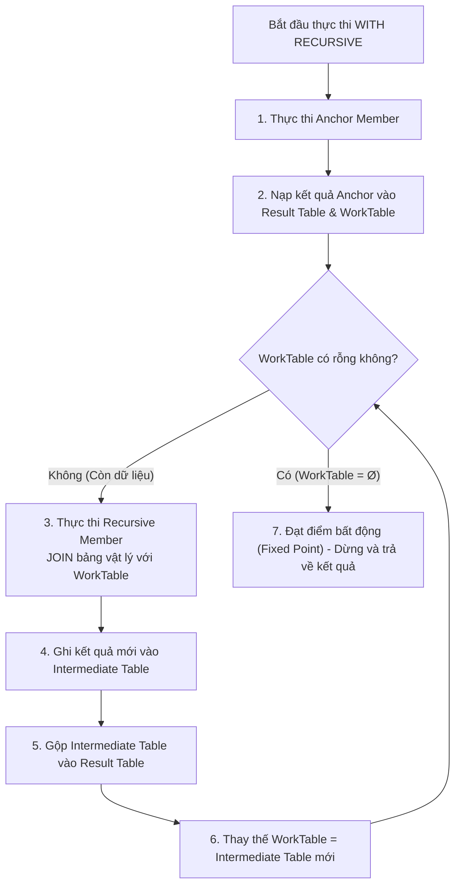

# 04. PHÂN TÍCH CHUYÊN SÂU: TRUY VẤN ĐỆ QUY WITH RECURSIVE & ĐỒ THỊ

---

## 1. Nền tảng Lý thuyết & Cơ chế Đánh giá Đệ quy trong PostgreSQL

Truy vấn đệ quy trong chuẩn SQL:1999 (được hiện thực trong PostgreSQL qua cú pháp `WITH RECURSIVE`) bắt nguồn từ lý thuyết **Datalog** và **Bao đóng chuyển tiếp (Transitive Closure)** trong đại số quan hệ.

### 1.1. Cấu trúc Tổng quát của CTE Đệ quy
Một câu lệnh `WITH RECURSIVE` luôn bao gồm hai thành phần được kết hợp bởi `UNION` hoặc `UNION ALL`:

$$\text{CTE} = \text{Anchor Member} \cup \text{Recursive Member}$$

```sql
WITH RECURSIVE cte_name AS (
    -- 1. Anchor Member (Phần cơ sở / Điểm neo): không tham chiếu đến cte_name
    SELECT ...
    UNION ALL
    -- 2. Recursive Member (Phần đệ quy): tham chiếu đến chính cte_name
    SELECT ... FROM cte_name JOIN table_name ON ...
)
SELECT * FROM cte_name;
```

### 1.2. Cơ chế Thực thi Nội bộ (Semi-naïve Evaluation & WorkTable)
PostgreSQL không thực thi đệ quy theo kiểu ngăn xếp hàm (call stack) như các ngôn ngữ lập trình truyền thống (C/Python), mà sử dụng **cơ chế đánh giá bán ngây thơ (Semi-naïve Evaluation)** với một bảng tạm trong bộ nhớ gọi là `WorkTable`:



> **Nguyên lý quan trọng**: Ở mỗi vòng lặp thứ $k$, `WorkTable` **chỉ chứa các dòng mới được sinh ra từ vòng lặp $k-1$**, chứ không chứa toàn bộ kết quả tích lũy. Điều này giúp loại trừ việc thực hiện lại các phép JOIN dư thừa từ các bước trước đó.

---

## 2. Phân tích Chi tiết 5 Bài toán SQL Học thuật

### Bài toán 1: Tìm người dùng trong mạng lưới theo dõi trong N bước (N-Hop Reachability)
- **Mục tiêu**: Tìm tất cả học giả mà người dùng $A$ có thể chạm tới trong phạm vi tối đa $N$ bước theo dõi.
- **Vấn đề cốt lõi**: Trong đồ thị theo dõi mạng xã hội, chu trình ($A \to B \to A$) xảy ra rất phổ biến. Nếu không có cơ chế chặn, vòng lặp đệ quy sẽ chạy mãi mãi dẫn đến tràn bộ nhớ (`out of memory`) hoặc tràn đĩa (`WorkTable disk spill`).
- **Giải pháp**: Sử dụng mảng động `ARRAY[follower_id, following_id]` để ghi nhận đường đi và kiểm tra `NOT (f.following_id = ANY(n.path))` trước khi mở rộng nút tiếp theo.

```sql
WITH RECURSIVE network AS (
    -- Anchor: các liên kết trực tiếp bậc 1 (depth = 1)
    SELECT 
        following_id AS user_id, 
        1 AS depth, 
        ARRAY[follower_id, following_id] AS path
    FROM follows 
    WHERE follower_id = $1

    UNION ALL

    -- Recursive: duyệt liên kết bậc n + 1
    SELECT 
        f.following_id, 
        n.depth + 1, 
        n.path || f.following_id
    FROM network n
    JOIN follows f ON f.follower_id = n.user_id
    WHERE n.depth < $2 
      AND NOT (f.following_id = ANY(n.path)) -- Khử chu trình
)
SELECT 
    u.user_id,
    u.name,
    u.institution,
    MIN(n.depth) AS distance,
    COUNT(n.path) AS total_paths_count,
    json_agg(n.path) AS found_paths
FROM network n
JOIN users u ON u.user_id = n.user_id
GROUP BY u.user_id, u.name, u.institution
ORDER BY distance ASC, u.name ASC;
```

---

### Bài toán 2: Tìm đường đi ngắn nhất giữa hai nhà nghiên cứu (Researcher Shortest Path Finder)
- **Mục tiêu**: Cho trước hai học giả $A$ và $B$, tìm chuỗi liên kết ngắn nhất kết nối từ $A$ sang $B$.
- **Cơ chế**: Triển khai thuật toán tìm kiếm theo chiều rộng (**Breadth-First Search - BFS**) trực tiếp trên quan hệ bảng. Do đệ quy tăng dần `depth = pf.depth + 1`, các đường đi có `depth` nhỏ nhất sẽ được sinh ra trước. Cờ `found` chặn việc mở rộng thêm khi đã chạm đích.
- **Tái tạo thông tin nút trung gian**: Sử dụng hàm `unnest(path) WITH ORDINALITY` để JOIN ngược lại bảng `users`, trả về danh sách đầy đủ tên, viện trường của từng học giả trên đường đi dưới dạng JSON:

```sql
WITH RECURSIVE path_finder AS (
    SELECT 
        follower_id AS current_node,
        following_id AS next_node,
        1 AS depth,
        ARRAY[follower_id, following_id] AS path,
        (following_id = $2) AS found
    FROM follows
    WHERE follower_id = $1

    UNION ALL

    SELECT 
        f.follower_id,
        f.following_id,
        pf.depth + 1,
        pf.path || f.following_id,
        (f.following_id = $2) AS found
    FROM path_finder pf
    JOIN follows f ON f.follower_id = pf.next_node
    WHERE pf.depth < 5
      AND NOT (f.following_id = ANY(pf.path))
      AND pf.found = FALSE
)
SELECT 
    depth AS distance,
    path,
    (
        SELECT json_agg(json_build_object(
            'user_id', u.user_id, 
            'name', u.name, 
            'institution', u.institution
        ))
        FROM unnest(path) WITH ORDINALITY AS p(uid, ord)
        JOIN users u ON u.user_id = p.uid
    ) AS path_nodes
FROM path_finder
WHERE next_node = $2
ORDER BY depth ASC
LIMIT 10;
```

---

### Bài toán 3: Truy vấn bình luận phân cấp theo cây (Threaded Tree Query)
- **Mục tiêu**: Lấy toàn bộ cây thảo luận thuộc một bài viết, hiển thị phản hồi con nằm ngay dưới phản hồi cha theo thứ tự phân cấp tự nhiên (Depth-First Search), loại bỏ hoàn toàn việc phải chạy đệ quy lặp trên ứng dụng.
- **Kỹ thuật mảng đường dẫn sắp xếp (`sort_path`)**:
  - Tại gốc (depth 0): `sort_path = ARRAY[c.comment_id]` (VD: `{1}`).
  - Tại con (depth 1): `sort_path = parent.sort_path || c.comment_id` (VD: `{1, 2}`).
  - Tại cháu (depth 2): `sort_path = {1, 2, 3}`.
  - Khi thực hiện `ORDER BY sort_path ASC`, PostgreSQL sẽ so sánh mảng theo từ điển (lexicographical order), đảm bảo tất cả con cháu của `{1}` đều xuất hiện trước nhánh `{5}`:

```sql
WITH RECURSIVE comment_tree AS (
    -- Điểm neo: các bình luận gốc cấp cao nhất
    SELECT 
        c.comment_id,
        c.post_id,
        c.user_id,
        c.parent_id,
        c.content,
        c.created_at,
        0 AS depth,
        ARRAY[c.comment_id] AS sort_path
    FROM comments c
    WHERE c.post_id = $1 AND c.parent_id IS NULL

    UNION ALL

    -- Bước đệ quy: gắn các bình luận trả lời vào nhánh cha
    SELECT 
        c.comment_id,
        c.post_id,
        c.user_id,
        c.parent_id,
        c.content,
        c.created_at,
        ct.depth + 1,
        ct.sort_path || c.comment_id
    FROM comments c
    JOIN comment_tree ct ON c.parent_id = ct.comment_id
)
SELECT 
    ct.comment_id,
    ct.parent_id,
    ct.content,
    ct.depth,
    ct.sort_path,
    u.name AS author_name,
    u.avatar_url AS author_avatar,
    (SELECT COUNT(*) FROM comments child WHERE child.parent_id = ct.comment_id) AS direct_replies_count
FROM comment_tree ct
JOIN users u ON u.user_id = ct.user_id
ORDER BY ct.sort_path ASC;
```

---

### Bài toán 4: Gợi ý học giả cộng tác tiềm năng (Collaborative Filtering Recommendation)
- **Mô hình chấm điểm heuristic học thuật**:
  - Người được theo dõi bởi những người tôi theo dõi (bạn của bạn - 2-Hop): trọng số $+1.5\text{ điểm}$.
  - Người cùng tham gia chung phòng nghiên cứu / lab: trọng số $+2.0\text{ điểm}$.
  - Người có chung từ khóa đề tài khoa học (`research_fields`): trọng số $+1.0\text{ điểm}$.
  - Loại trừ chính người dùng hiện tại và những người đã được theo dõi:

```sql
WITH user_followings AS (
    SELECT following_id FROM follows WHERE follower_id = $1
),
user_groups AS (
    SELECT group_id FROM group_members WHERE user_id = $1
),
candidate_pool AS (
    -- 1. 2-Hop Network (Bạn của người tôi theo dõi)
    SELECT f.following_id AS candidate_id, 1.5 AS weight, 'mutual_follow' AS reason
    FROM follows f
    WHERE f.follower_id IN (SELECT following_id FROM user_followings)
      AND f.following_id <> $1 AND f.following_id NOT IN (SELECT following_id FROM user_followings)

    UNION ALL

    -- 2. Thành viên chung phòng Lab
    SELECT gm.user_id AS candidate_id, 2.0 AS weight, 'shared_group' AS reason
    FROM group_members gm
    WHERE gm.group_id IN (SELECT group_id FROM user_groups)
      AND gm.user_id <> $1 AND gm.user_id NOT IN (SELECT following_id FROM user_followings)
)
SELECT 
    u.user_id, u.name, u.institution, u.avatar_url,
    ROUND(SUM(cp.weight)::numeric, 2) AS recommendation_score,
    COUNT(DISTINCT CASE WHEN cp.reason = 'mutual_follow' THEN 1 END) AS mutual_connections_count,
    COUNT(DISTINCT CASE WHEN cp.reason = 'shared_group' THEN 1 END) AS shared_groups_count
FROM candidate_pool cp
JOIN users u ON u.user_id = cp.candidate_id
GROUP BY u.user_id, u.name, u.institution, u.avatar_url
ORDER BY recommendation_score DESC, mutual_connections_count DESC
LIMIT 10;
```

---

### Bài toán 5: Phát hiện chu trình trong quan hệ theo dõi (Cycle Detection)
- **Mục tiêu**: Phát hiện xem người dùng $A$ có nằm trong một vòng lặp theo dõi khép kín không (ví dụ $A \to B \to C \to A$).
- **Nguyên lý**: Điểm neo xuất phát từ $A$. Trong bước đệ quy, nếu `f.following_id = $1` (quay lại nút ban đầu) ở độ sâu $> 1$, ta đánh dấu cờ `is_cycle = TRUE` và hoàn thành chu trình:

```sql
WITH RECURSIVE cycle_finder AS (
    SELECT 
        follower_id, following_id, 1 AS depth, 
        ARRAY[follower_id, following_id] AS path,
        (following_id = $1) AS is_cycle
    FROM follows
    WHERE follower_id = $1

    UNION ALL

    SELECT 
        f.follower_id, f.following_id, cf.depth + 1, 
        cf.path || f.following_id,
        (f.following_id = $1) AS is_cycle
    FROM cycle_finder cf
    JOIN follows f ON f.follower_id = cf.following_id
    WHERE cf.depth < 4
      AND cf.is_cycle = FALSE
      AND (f.following_id = $1 OR NOT (f.following_id = ANY(cf.path)))
)
SELECT depth AS cycle_length, path 
FROM cycle_finder 
WHERE is_cycle = TRUE AND depth > 1
ORDER BY depth ASC;
```

---

## 3. Phân tích Độ phức tạp Thời gian & Không gian

| Bài toán | Độ phức tạp Thời gian (Worst Case) | Độ phức tạp Không gian (WorkTable Memory) | Giải pháp Kiểm soát Chi phí |
| :--- | :--- | :--- | :--- |
| **N-Hop Reachability** | $O(V + E)$ với độ sâu thấp; tăng theo số mũ $O(d^k)$ nếu đồ thị dày | $O(K \times \text{path\_length})$ lưu trong bộ nhớ tạm | Bắt buộc chặn `depth < N` (thường $N \le 4$) và composite index `(follower_id, following_id)`. |
| **Shortest Path** | $O(b^d)$ với $b$ là hệ số phân nhánh, $d$ là khoảng cách | $O(b^d)$ | Dừng sớm với cờ `found = TRUE` và chặn quay lui `ANY(path)`. |
| **Cây Bình luận** | $O(N)$ trong đó $N$ là tổng số bình luận thuộc bài viết | $O(N)$ | B-tree index `(post_id, parent_id)` giúp lọc trực tiếp chỉ các bình luận của bài viết. |
| **Cycle Detection** | $O(V^k)$ với $k$ là độ dài chu trình tối đa | $O(k \times \text{cycles})$ | Giới hạn độ dài chu trình $k \le 4$. |
