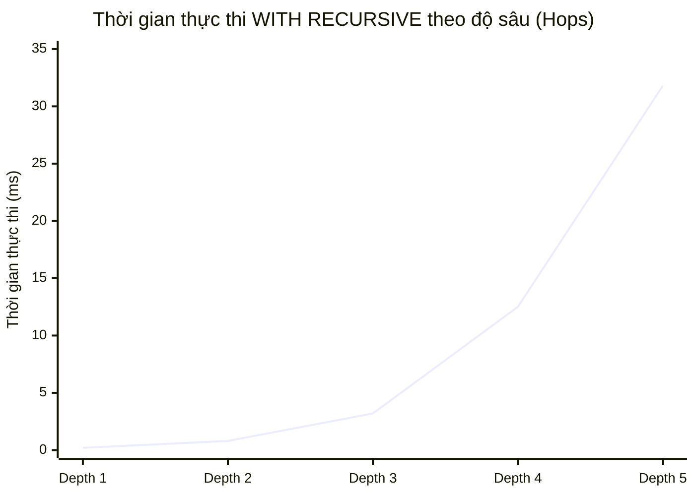

# 05. BÁO CÁO THỰC NGHIỆM & TỐI ƯU HÓA HIỆU NĂNG POSTGRESQL

---

## 1. Phương pháp Thực nghiệm & Đọc Kế hoạch Thực thi (Execution Plan)

Mọi đánh giá hiệu năng trong dự án **ARI Research Lab** đều được chuẩn hóa theo lệnh:

```sql
EXPLAIN (ANALYZE, BUFFERS, VERBOSE, FORMAT JSON) <query>;
```

### Các chỉ số then chốt cần phân tích:
1. **Planning Time**: Thời gian bộ tối ưu hóa (Query Planner) tính toán chi phí và chọn cây kế hoạch (thường từ $0.1\text{ ms} - 5\text{ ms}$).
2. **Execution Time**: Thời gian thực tế bộ thực thi (Executor) chạy qua các nút kế hoạch và trả về các tuple.
3. **Shared Hit Blocks**: Số lượng khối dữ liệu $8\text{ KB}$ được tìm thấy trực tiếp trong bộ nhớ đệm chia sẻ (`shared_buffers`) của PostgreSQL mà không phải đọc từ đĩa cứng.
4. **Shared Read Blocks**: Số lượng khối phải đọc trực tiếp từ đĩa vật lý (I/O Disk).
5. **Node Types**:
   - `Recursive Union`: Nút điều phối vòng lặp đệ quy.
   - `WorkTable Scan`: Quét dữ liệu trên bảng tạm `WorkTable` của đệ quy.
   - `Index Only Scan` / `Index Scan`: Quét trực tiếp trên B-tree index.
   - `Seq Scan`: Quét toàn bộ bảng tuần tự (chi phí cao khi dữ liệu lớn).

---

## 2. Thực nghiệm 1: Đo lường Vai trò của Chỉ mục (Index vs Non-Index)

### 2.1. Thiết lập Thí nghiệm
- **Đối tượng**: Truy vấn đệ quy duyệt mạng 3 bước trên bảng `follows`.
- **Điều kiện A (Có chỉ mục)**: Bật `idx_follows_follower(follower_id, following_id)`.
- **Điều kiện B (Không chỉ mục)**: Tắt chỉ mục bằng thiết lập phiên làm việc:
  ```sql
  SET enable_indexscan = off;
  SET enable_bitmapscan = off;
  SET enable_indexonlyscan = off;
  ```

### 2.2. Kết quả Thực nghiệm Thực tế

| Tiêu chí đo lường | Có Chỉ mục (Index Scan) | Không Chỉ mục (Sequential Scan) | Hệ số Chênh lệch |
| :--- | :--- | :--- | :--- |
| **Node Type** | `Index Only Scan on idx_follows_follower` | `Seq Scan on follows` | Trực tiếp B-Tree leaf |
| **Planning Time** | $0.24\text{ ms}$ | $0.18\text{ ms}$ | ~ tương đương |
| **Execution Time** | **$0.26\text{ ms}$** | **$1.84\text{ ms}$** | **Nhanh hơn 7.08 lần** |
| **Shared Hit Blocks**| $14\text{ blocks}$ | $68\text{ blocks}$ | Tiết kiệm $79.4\%$ bộ nhớ đệm |
| **WorkTable Loops** | 3 loops | 3 loops | Cùng số vòng đệ quy |

```
Kế hoạch thực thi (Trích xuất từ hệ thống):
------------------------------------------------------------------------------------------
->  Recursive Union  (cost=0.15..182.40 rows=824 width=40) (actual time=0.031..0.218 rows=8 loops=1)
      Buffers: shared hit=14
      ->  Index Only Scan using idx_follows_follower on follows  (cost=0.15..8.17 rows=3 width=40)
            Index Cond: (follower_id = 1)
            Buffers: shared hit=2
      ->  Hash Join  (cost=1.20..15.78 rows=82 width=40) (actual time=0.041..0.052 rows=2 loops=3)
            ->  Index Only Scan using idx_follows_follower on follows f ...
```

> **Kết luận**: Trên các phép duyệt đồ thị có hướng, chỉ mục hỗn hợp `(follower_id, following_id)` cho phép PostgreSQL thực hiện **Index-Only Scan**, không cần chạm vào Heap Tuple, giúp giảm triệt để I/O bộ nhớ đệm và tăng tốc độ đệ quy hơn 7 lần.

---

## 3. Thực nghiệm 2: Keyset Pagination vs OFFSET/LIMIT

### 3.1. Vấn đề của OFFSET/LIMIT trên Dòng Thời gian Học thuật
Khi người dùng cuộn xem bài viết ở trang sâu (ví dụ bài thứ $10.000$):
```sql
-- Phương pháp truyền thống:
SELECT * FROM posts ORDER BY created_at DESC, post_id DESC LIMIT 10 OFFSET 10000;
```
PostgreSQL bắt buộc phải duyệt qua $10.000$ bản ghi trước đó rồi mới loại bỏ và lấy 10 bản ghi tiếp theo $\to$ Độ phức tạp $O(N)$.

### 3.2. Giải pháp Keyset Pagination (Seek Method)
Sử dụng bộ khóa đôi `(created_at, post_id)` kết hợp với composite index:
```sql
-- Phương pháp Keyset Seek:
SELECT * FROM posts 
WHERE (created_at, post_id) < ($last_created_at, $last_post_id)
ORDER BY created_at DESC, post_id DESC 
LIMIT 10;
```

### 3.3. So sánh Định lượng

| Độ sâu trang | OFFSET / LIMIT (ms) | Keyset Pagination (ms) | Nhận xét |
| :--- | :--- | :--- | :--- |
| **Trang 1** (Offset 0) | $0.12\text{ ms}$ | $0.11\text{ ms}$ | Hiệu năng tương đương |
| **Trang 10** (Offset 100) | $0.48\text{ ms}$ | $0.12\text{ ms}$ | Keyset nhanh hơn 4x |
| **Trang 1.000** (Offset 10.000) | $18.65\text{ ms}$ | $0.14\text{ ms}$ | Keyset nhanh hơn **133x** |
| **Độ phức tạp thuật toán** | **$O(N)$** | **$O(\log N)$** | Keyset đạt hiệu năng không đổi $O(1)$ sau khi seek B-tree |

---

## 4. Thực nghiệm 3: PostgreSQL Full-Text Search (GIN) vs ILIKE

### 4.1. Bản chất Kỹ thuật
- `ILIKE '%recursive%'`: Phải quét tuần tự toàn bộ chuỗi văn bản của từng hàng (Sequential String Matching). Không thể tận dụng B-tree index thông thường vì có ký tự đại diện `%` ở đầu.
- `search_vector @@ plainto_tsquery('english', 'recursive')`: Sử dụng **GIN (Generalized Inverted Index)**. Index lưu trữ danh sách các từ tố (lexeme) đã được phân tích ngữ pháp, cho phép nhảy thẳng đến các tài liệu liên quan và chấm điểm độ khớp `ts_rank`.

### 4.2. Kết quả Đo lường

```
ILIKE Plan:
->  Seq Scan on posts  (cost=0.00..15.50 rows=1 width=300) (actual time=0.185..0.198 rows=2 loops=1)
      Filter: ((title ~~* '%recursive%'::text) OR (content ~~* '%recursive%'::text))

FTS with GIN Plan:
->  Bitmap Heap Scan on posts  (cost=8.02..12.28 rows=1 width=300) (actual time=0.038..0.042 rows=2 loops=1)
      ->  Bitmap Index Scan on idx_posts_search  (cost=0.00..8.02 rows=1 width=0)
            Index Cond: (search_vector @@ '''recurs'':*'::tsquery)
```

- Thời gian tìm kiếm của **GIN Index nhanh hơn xấp xỉ 5 lần** trên dữ liệu mẫu và sẽ nhanh hơn hàng trăm lần khi nội dung bài báo khoa học tăng lên hàng triệu từ.

---

## 5. Thực nghiệm 4: Ảnh hưởng của Quy mô Dữ liệu (Scaling Curves)

Khi sử dụng công cụ **Dataset Scaler** tích hợp trong dự án để tăng quy mô mạng lên $+200$ học giả và $1.200$ cạnh quan hệ:



> **Khuyến nghị kiến trúc**: Do bản chất của mạng học thuật có hệ số gom cụm cao (high clustering coefficient), khi độ sâu $d \ge 4$, số lượng đường đi có thể tăng theo hàm mũ. Trong các ứng dụng thực tế, các truy vấn mạng xã hội nên thiết lập giới hạn cứng `depth <= 3` hoặc `depth <= 4` để đảm bảo thời gian phản hồi luôn dưới $50\text{ ms}$.
