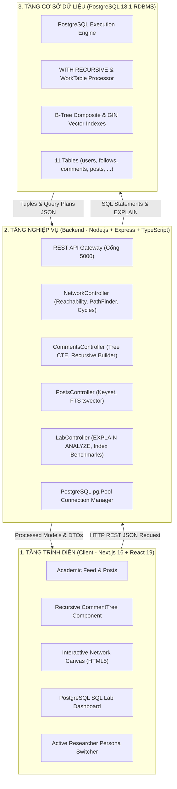
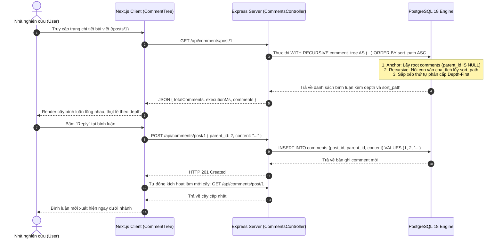
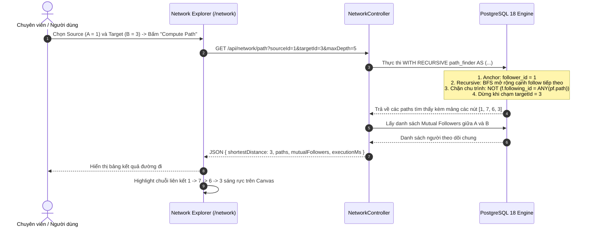
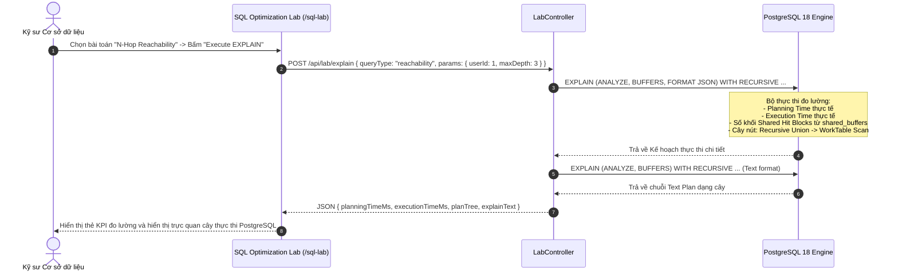

# 06. KIẾN TRÚC HỆ THỐNG & SƠ ĐỒ TUẦN TỰ (SEQUENCE DIAGRAMS)

---

## 1. Kiến trúc Hệ thống 3 Tầng (3-Tier Architecture)

Hệ thống **ARI Research Lab** được xây dựng theo mô hình phân tầng chặt chẽ, tách biệt hoàn toàn giữa giao diện người dùng, logic nghiệp vụ máy chủ và tầng dữ liệu quan hệ:

---

## 2. Sơ đồ Tuần tự (Sequence Diagrams)

### 2.1. Sơ đồ Tuần tự: Truy vấn & Hiển thị Cây Bình luận Đa cấp

---

### 2.2. Sơ đồ Tuần tự: Dò tìm Đường đi Ngắn nhất Giữa 2 Nhà Nghiên cứu

---

### 2.3. Sơ đồ Tuần tự: Thực nghiệm EXPLAIN (ANALYZE, BUFFERS) từ SQL Lab

