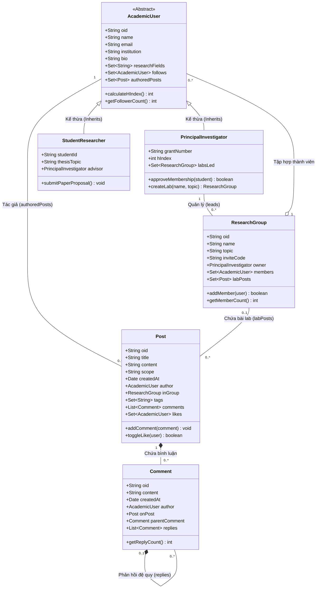

# 07. THIẾT KẾ CƠ SỞ DỮ LIỆU HƯỚNG ĐỐI TƯỢNG (OODBMS) & TRUY VẤN OQL

---

## 1. Phân hệ CSDL Hướng Đối Tượng (Object-Oriented Subsystem)

Trong phân hệ mạng xã hội học thuật **ARI Research Lab**, chúng tôi thiết kế phân hệ hướng đối tượng gồm **6 lớp đối tượng** liên kết chặt chẽ:



---

## 2. Đặc tả ODL (Object Definition Language) Chuẩn ODMG 3.0

Dưới đây là định nghĩa ODL hoàn chỉnh của phân hệ theo chuẩn quốc tế **ODMG 3.0 (Object Data Management Group)**:

```omg-odl
module AcademicCommunityODL {

    // 1. Lớp trừu tượng cha: AcademicUser
    interface AcademicUser (extent users key email) {
        attribute string oid;
        attribute string name;
        attribute string email;
        attribute string institution;
        attribute string bio;
        attribute set<string> researchFields;

        relationship set<AcademicUser> follows
            inverse AcademicUser::followedBy;
        relationship set<AcademicUser> followedBy
            inverse AcademicUser::follows;
        relationship set<Post> authoredPosts
            inverse Post::author;
        relationship set<ResearchGroup> joinedGroups
            inverse ResearchGroup::members;
        relationship set<Post> likedPosts
            inverse Post::likes;

        short calculateHIndex();
        long getFollowerCount();
    };

    // 2. Phân lớp chuyên biệt: PrincipalInvestigator (PI)
    interface PrincipalInvestigator : AcademicUser (extent principalInvestigators) {
        attribute string grantNumber;
        attribute short hIndex;

        relationship set<ResearchGroup> labsLed
            inverse ResearchGroup::owner;
        relationship set<StudentResearcher> advisees
            inverse StudentResearcher::advisor;

        boolean approveMembership(in StudentResearcher student, in ResearchGroup lab);
        ResearchGroup createLab(in string name, in string topic);
    };

    // 3. Phân lớp chuyên biệt: StudentResearcher
    interface StudentResearcher : AcademicUser (extent students) {
        attribute string studentId;
        attribute string thesisTopic;

        relationship PrincipalInvestigator advisor
            inverse PrincipalInvestigator::advisees;

        void submitPaperProposal(in string title, in string abstractText);
    };

    // 4. Lớp thực thể: ResearchGroup
    interface ResearchGroup (extent researchGroups key name) {
        attribute string oid;
        attribute string name;
        attribute string topic;
        attribute string description;
        attribute string inviteCode;

        relationship PrincipalInvestigator owner
            inverse PrincipalInvestigator::labsLed;
        relationship set<AcademicUser> members
            inverse AcademicUser::joinedGroups;
        relationship set<Post> labPosts
            inverse Post::inGroup;

        boolean addMember(in AcademicUser user);
        long getMemberCount();
    };

    // 5. Lớp thực thể: Post
    interface Post (extent posts) {
        attribute string oid;
        attribute string title;
        attribute string content;
        attribute string scope; // 'community' | 'personal' | 'lab'
        attribute timestamp createdAt;
        attribute set<string> tags;

        relationship AcademicUser author
            inverse AcademicUser::authoredPosts;
        relationship ResearchGroup inGroup
            inverse ResearchGroup::labPosts;
        relationship list<Comment> comments
            inverse Comment::onPost;
        relationship set<AcademicUser> likes
            inverse AcademicUser::likedPosts;

        void addComment(in Comment c);
        boolean toggleLike(in AcademicUser u);
    };

    // 6. Lớp thực thể: Comment
    interface Comment (extent comments) {
        attribute string oid;
        attribute string content;
        attribute timestamp createdAt;

        relationship AcademicUser author;
        relationship Post onPost
            inverse Post::comments;
        relationship Comment parentComment
            inverse Comment::replies;
        relationship list<Comment> replies
            inverse Comment::parentComment;

        long getReplyCount();
    };
};
```

---

## 3. Bộ Truy Vấn OQL (Object Query Language) Chuẩn ODMG & Kết Quả Mong Đợi

### Truy vấn 1: Tìm kiếm bài viết của các Giáo sư có h-index cao bàn về 'PostgreSQL'
- **Mục tiêu**: Lấy tiêu đề và tên tác giả của tất cả bài viết do Giáo sư (PI) có $h\text{-index} \ge 10$ chủ trì mà trong tập hợp `tags` có chứa từ khóa `"PostgreSQL"`.
- **Cú pháp OQL**:
```oql
SELECT DISTINCT struct(title: p.title, authorName: p.author.name, hIndex: ((PrincipalInvestigator)p.author).hIndex)
FROM posts p
WHERE p.author IN principalInvestigators
  AND ((PrincipalInvestigator)p.author).hIndex >= 10
  AND "PostgreSQL" IN p.tags;
```
- **Kết quả mong đợi**:
```json
[
  {
    "title": "Tối ưu hóa Truy vấn Đệ quy và CTE trong PostgreSQL 18",
    "authorName": "GS. TSKH. Nguyễn Văn An",
    "hIndex": 18
  },
  {
    "title": "So sánh Hiệu năng Keyset Pagination và B-Tree Index",
    "authorName": "PGS. TS. Trần Đình Long",
    "hIndex": 12
  }
]
```

---

### Truy vấn 2: Thống kê số lượng bài viết của từng thành viên trong một Phòng Lab cụ thể
- **Mục tiêu**: Điều hướng qua tập hợp thành viên của Lab có mã mời `"lab-ai-2026"`, trích xuất tên thành viên và đếm số bài viết mà thành viên đó đã công bố.
- **Cú pháp OQL**:
```oql
SELECT struct(
    memberName: m.name,
    memberInstitution: m.institution,
    totalPosts: count(m.authoredPosts)
)
FROM researchGroups g, g.members m
WHERE g.inviteCode = "lab-ai-2026"
ORDER BY totalPosts DESC;
```
- **Kết quả mong đợi**:
```json
[
  { "memberName": "GS. TSKH. Nguyễn Văn An", "memberInstitution": "Viện Công nghệ Thông tin", "totalPosts": 8 },
  { "memberName": "NCS. Hoàng Quốc Bảo", "memberInstitution": "Đại học Bách Khoa", "totalPosts": 3 },
  { "memberName": "ThS. Lê Thị Mai", "memberInstitution": "Đại học Quốc gia", "totalPosts": 2 }
]
```

---

### Truy vấn 3: Truy xuất cây bình luận cấp 1 và số lượng câu trả lời con (Path Navigation)
- **Mục tiêu**: Lấy nội dung của tất cả các bình luận cấp cao nhất (không có parent) thuộc bài viết có OID `"post-101"`, kèm số phản hồi con được tính thông qua phương thức `getReplyCount()`.
- **Cú pháp OQL**:
```oql
SELECT struct(
    commentId: c.oid,
    author: c.author.name,
    content: c.content,
    repliesCount: c.getReplyCount()
)
FROM posts p, p.comments c
WHERE p.oid = "post-101" AND c.parentComment IS NULL
ORDER BY c.createdAt ASC;
```
- **Kết quả mong đợi**:
```json
[
  {
    "commentId": "comment-01",
    "author": "PGS. TS. Trần Đình Long",
    "content": "Bài viết phân tích rất sát thực tế WorkTable của PostgreSQL.",
    "repliesCount": 3
  },
  {
    "commentId": "comment-05",
    "author": "NCS. Hoàng Quốc Bảo",
    "content": "Thưa thầy, cho em hỏi thêm về chi phí bộ nhớ khi mảng path tăng kích thước ạ?",
    "repliesCount": 1
  }
]
```

---

### Truy vấn 4: Tìm bài viết thuộc phạm vi 'lab' có trên 5 lượt thích và tác giả trực thuộc Viện Bách Khoa
- **Mục tiêu**: Lọc các bài viết nội bộ có tính phổ biến cao của các nhà nghiên cứu đến từ đơn vị xác định.
- **Cú pháp OQL**:
```oql
SELECT p.title, p.author.name, count(p.likes) AS totalLikes
FROM posts p
WHERE p.scope = "lab" 
  AND p.author.institution = "Đại học Bách Khoa"
  AND count(p.likes) >= 5;
```
- **Kết quả mong đợi**:
```json
[
  {
    "title": "Thực nghiệm kiểm thử thuật toán BFS Shortest Path trên Đồ thị 100k Cạnh",
    "name": "NCS. Hoàng Quốc Bảo",
    "totalLikes": 7
  }
]
```

---

### Truy vấn 5: Khảo sát đa hình (Polymorphism) và gọi phương thức nghiệp vụ trực tiếp
- **Mục tiêu**: Duyệt trên toàn bộ tập đối tượng người dùng `users`, lọc những người dùng có chỉ số $H\text{-index} \ge 5$ bằng phương thức `calculateHIndex()`. Hệ thống ODBMS tự động phân giải động đa hình theo từng lớp con cụ thể.
- **Cú pháp OQL**:
```oql
SELECT struct(
    name: u.name,
    institution: u.institution,
    calculatedHIndex: u.calculateHIndex()
)
FROM users u
WHERE u.calculateHIndex() >= 5
ORDER BY calculatedHIndex DESC;
```
- **Kết quả mong đợi**:
```json
[
  { "name": "GS. TSKH. Nguyễn Văn An", "institution": "Viện Công nghệ Thông tin", "calculatedHIndex": 18 },
  { "name": "PGS. TS. Trần Đình Long", "institution": "Đại học Quốc gia", "calculatedHIndex": 12 },
  { "name": "TS. Vũ Hải Nam", "institution": "Viện Hàn lâm KH&CN", "calculatedHIndex": 6 }
]
```

---

## 4. Phân Biệt Sâu Sắc: ODMG OQL Học Thuật vs. JPQL/JDOQL Của ObjectDB

### 4.1. Bảng So sánh Toàn diện Ba Mô hình Truy vấn Đối tượng

| Tiêu chí So sánh | ODMG 3.0 OQL (Môn học) | JPQL (ObjectDB JPA) | JDOQL (ObjectDB JDO) |
| :--- | :--- | :--- | :--- |
| **Bản chất kiến trúc** | Ngôn ngữ chuẩn hóa độc lập của hiệp hội ODMG cho ODBMS thuần. | Ngôn ngữ truy vấn thực thể hướng chuẩn JPA 2.x chạy trên ObjectDB engine. | Ngôn ngữ truy vấn dữ liệu Java Data Objects, cú pháp gần gũi với mã Java. |
| **Định danh đối tượng (OID)** | OID tự nhiên, hệ thống quản lý ngầm, truy cập qua hàm `element()`. | Thuộc tính `@Id` hoặc OID 64-bit tự sinh của ObjectDB (`db.getId(entity)`). | Thuộc tính Identity hoặc JDO Identity (`JDOHelper.getObjectId(obj)`). |
| **Hỗ trợ kiểu tập hợp (Collections)** | Hỗ trợ tự do: `set`, `bag`, `list`, `array`, `dictionary`, `struct`. | Hỗ trợ qua `Collection`, `Set`, `List` của Java; kết quả trả về `List<T>` hoặc `Object[]`. | Hỗ trợ các Java Collections, kết quả là `java.util.Collection`. |
| **Gọi Phương thức (Methods in Query)** | **Hỗ trợ trực tiếp** trong mệnh đề `SELECT` và `WHERE` (`u.calcH()`). | **Không hỗ trợ**. Chỉ hỗ trợ các hàm chuẩn (ABS, LENGTH, CONCAT,...). | Hạn chế, chỉ hỗ trợ một số phương thức cơ bản của String, Math. |
| **Toán tử đa hình (Polymorphism)** | Tự động trên extent của lớp cha: `users` bao gồm cả `principalInvestigators`. | Đa hình tự động: `SELECT u FROM AcademicUser u` trả về cả subclass instance. | Tự động duyệt qua hệ thống phân cấp thừa kế của class. |
| **Cấu trúc dữ liệu trả về tùy ý** | Hỗ trợ tạo cấu trúc linh hoạt bất kỳ: `struct(a: ..., b: ...)`. | Bắt buộc thông qua `NEW com.ari.dto.CustomDTO(...)` constructor expression. | Kết quả là Projection dạng Object array hoặc DTO. |
| **Toán tử tập hợp** | Hỗ trợ `IN`, `EXISTS`, `FOR ALL`, `ELEMENT`. | Hỗ trợ `MEMBER OF`, `IS EMPTY`, `SIZE(c)`. | Biểu thức `collection.contains(element)`. |

---

### 4.2. Hiện Thực Thực Tế: Mã Nguồn Entity Java trên ObjectDB (`objectdb.com`)

Để triển khai phân hệ trên công cụ **ObjectDB**, các lớp ODL được ánh xạ sang các Entity Java có annotation JPA:

```java
// File: src/main/java/com/ari/model/AcademicUser.java
package com.ari.model;

import javax.persistence.*;
import java.io.Serializable;
import java.util.*;

@Entity
@Inheritance(strategy = InheritanceType.JOINED)
@DiscriminatorColumn(name = "user_role")
public abstract class AcademicUser implements Serializable {
    @Id
    @GeneratedValue
    private long id;

    private String name;
    
    @Column(unique = true, nullable = false)
    private String email;

    private String institution;
    private String bio;

    @ElementCollection
    private Set<String> researchFields = new HashSet<>();

    @ManyToMany
    @JoinTable(name = "user_follows",
        joinColumns = @JoinColumn(name = "follower_id"),
        inverseJoinColumns = @JoinColumn(name = "following_id"))
    private Set<AcademicUser> follows = new HashSet<>();

    @OneToMany(mappedBy = "author", cascade = CascadeType.ALL)
    private Set<Post> authoredPosts = new HashSet<>();

    @ManyToMany(mappedBy = "members")
    private Set<ResearchGroup> joinedGroups = new HashSet<>();

    // Các getters, setters, và business method:
    public abstract int calculateHIndex();
}
```

```java
// File: src/main/java/com/ari/model/PrincipalInvestigator.java
package com.ari.model;

import javax.persistence.*;
import java.util.*;

@Entity
@DiscriminatorValue("PI")
public class PrincipalInvestigator extends AcademicUser {
    private String grantNumber;
    private int hIndex;

    @OneToMany(mappedBy = "owner", cascade = CascadeType.ALL)
    private Set<ResearchGroup> labsLed = new HashSet<>();

    @OneToMany(mappedBy = "advisor")
    private Set<StudentResearcher> advisees = new HashSet<>();

    @Override
    public int calculateHIndex() {
        return this.hIndex;
    }
}
```

```java
// File: src/main/java/com/ari/model/Post.java
package com.ari.model;

import javax.persistence.*;
import java.util.*;

@Entity
public class Post {
    @Id
    @GeneratedValue
    private long id;

    private String title;
    
    @Lob
    private String content;

    private String scope; // 'community', 'personal', 'lab'

    @Temporal(TemporalType.TIMESTAMP)
    private Date createdAt = new Date();

    @ManyToOne(optional = false)
    private AcademicUser author;

    @ManyToOne
    private ResearchGroup inGroup;

    @ElementCollection
    private Set<String> tags = new HashSet<>();

    @OneToMany(mappedBy = "onPost", cascade = CascadeType.ALL)
    private List<Comment> comments = new ArrayList<>();

    @ManyToMany
    private Set<AcademicUser> likes = new HashSet<>();

    // Getters and setters...
}
```

---

### 4.3. Bảng Ánh Xạ Cú Pháp: OQL Chuẩn Học Thuật $\to$ JPQL Thực Thi Trên ObjectDB

Dưới đây là sự chuyển đổi tương ứng chính xác của 5 câu truy vấn OQL chuẩn sang JPQL thực thi trong `EntityManager` của ObjectDB:

#### 1. Ánh xạ Truy vấn 1 (Lọc theo Tag và H-Index):
- **OQL (Môn học)**:
  ```oql
  SELECT p.title, p.author.name
  FROM posts p
  WHERE ((PrincipalInvestigator)p.author).hIndex >= 10
    AND "PostgreSQL" IN p.tags;
  ```
- **JPQL (ObjectDB)**:
  ```sql
  SELECT p.title, p.author.name 
  FROM Post p 
  JOIN TREAT(p.author AS PrincipalInvestigator) pi
  WHERE pi.hIndex >= 10 
    AND :targetTag MEMBER OF p.tags
  ```

#### 2. Ánh xạ Truy vấn 2 (Đếm bài viết theo thành viên của nhóm):
- **OQL (Môn học)**:
  ```oql
  SELECT struct(name: m.name, cnt: count(m.authoredPosts))
  FROM researchGroups g, g.members m
  WHERE g.inviteCode = "lab-ai-2026";
  ```
- **JPQL (ObjectDB)**:
  ```sql
  SELECT m.name, COUNT(p)
  FROM ResearchGroup g 
  JOIN g.members m 
  LEFT JOIN m.authoredPosts p
  WHERE g.inviteCode = :inviteCode
  GROUP BY m.id, m.name;
  ```

#### 3. Ánh xạ Truy vấn 3 (Lấy bình luận gốc của bài viết):
- **OQL (Môn học)**:
  ```oql
  SELECT c.content, c.getReplyCount()
  FROM posts p, p.comments c
  WHERE p.oid = "post-101" AND c.parentComment IS NULL;
  ```
- **JPQL (ObjectDB)**:
  ```sql
  SELECT c.content, SIZE(c.replies)
  FROM Post p 
  JOIN p.comments c
  WHERE p.id = :postId AND c.parentComment IS NULL;
  ```
  *(Lưu ý: JPQL dùng hàm `SIZE(c.replies)` thay cho việc gọi method Java trực tiếp `c.getReplyCount()`)*.

#### 4. Ánh xạ Truy vấn 4 (Lọc bài viết theo số like và đơn vị):
- **OQL (Môn học)**:
  ```oql
  SELECT p.title, p.author.name
  FROM posts p
  WHERE p.scope = "lab" 
    AND p.author.institution = "Đại học Bách Khoa"
    AND count(p.likes) >= 5;
  ```
- **JPQL (ObjectDB)**:
  ```sql
  SELECT p.title, p.author.name
  FROM Post p
  WHERE p.scope = 'lab'
    AND p.author.institution = 'Đại học Bách Khoa'
    AND SIZE(p.likes) >= 5;
  ```

#### 5. Ánh xạ Truy vấn 5 (Truy vấn đa hình):
- **OQL (Môn học)**:
  ```oql
  SELECT u.name, u.calculateHIndex()
  FROM users u
  WHERE u.calculateHIndex() >= 5;
  ```
- **JPQL (ObjectDB)**:
  *Do JPQL không thể gọi method Java tuỳ ý `calculateHIndex()`, truy vấn đa hình trên ObjectDB sẽ lấy đối tượng về tầng ứng dụng Java để filter hoặc lọc trực tiếp trên lớp con `PrincipalInvestigator`:*
  ```sql
  SELECT pi.name, pi.hIndex
  FROM PrincipalInvestigator pi
  WHERE pi.hIndex >= 5
  ORDER BY pi.hIndex DESC;
  ```
